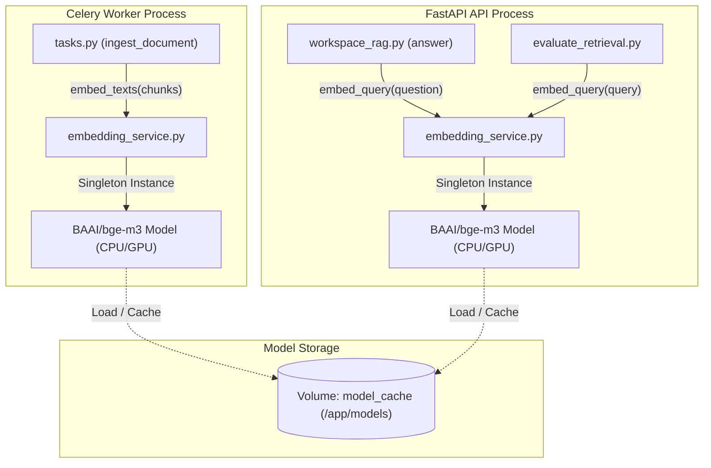
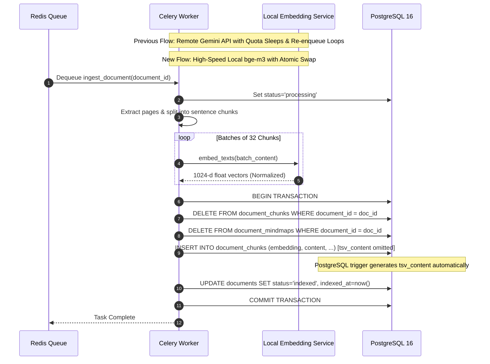

# Implementation Plan - Local BAAI/bge-m3 Embedding Migration & Ingestion Pipeline Hardening

## 1. Executive Summary and Migration Objectives

This implementation plan details the technical roadmap for migrating the Document Chatbot platform from the Google Gemini `gemini-embedding-001` external API to a locally-hosted `BAAI/bge-m3` embedding pipeline.
It also resolves two critical ingestion failure modes identified in platform logs:

1. **Gemini HTTP 429 Quota Exhaustion and Celery Retry Storms**:
   External API rate limiting causes document ingestion tasks to sleep repeatedly, fail, and restart from the beginning, leading to redundant chunk parsing and severe worker thread starvation.
2. **PostgreSQL Datatype Mismatch on `tsv_content`**:
   The SQLAlchemy ORM entity binds `tsv_content` as `VARCHAR` / `TEXT` in bulk insert parameters, which PostgreSQL rejects with `DatatypeMismatch` because the underlying column is typed as `tsvector`.

### Core Technical Goals

- **Complete Elimination of External Embedding Rate Limits**:
  All embedding computation for both document ingestion and query retrieval executes locally on CPU or GPU without external API dependencies.
- **Dimensionality Upgrade to 1024**:
  Transition from 384-dimensional truncated Gemini vectors to the native 1024-dimensional dense representations of `BAAI/bge-m3`.
- **Database Schema Correction**:
  Ensure `document_chunks.tsv_content` is managed cleanly by database triggers without ORM type collisions.
- **Resilient and Resumable Ingestion**:
  Redesign the Celery ingestion worker to process embedding batches efficiently, track batch progress, and prevent whole-document reprocessing upon task failure.
- **Preserved Hybrid Search Quality**:
  Maintain seamless integration with PostgreSQL BM25 full-text search, dense vector retrieval, and Reciprocal Rank Fusion ($k=60$).
- **Strict Decoupling of Generative vs Embedding Services**:
  Reclassify `GOOGLE_API_KEY` as strictly optional (used only if Gemini is chosen for mind map summarization instead of OpenRouter).

---

## 2. Root Cause Analysis of Ingestion Failures

### 2.1 Gemini HTTP 429 Rate Limits and Celery Task Amplification

In [`backend/app/tasks.py`](file:///home/shripad/Desktop/miniproject/ai-document-chatbot/backend/app/tasks.py), document ingestion currently operates as follows:
- The task `ingest_document(document_id)` receives a document, extracts text from disk, and splits pages into sentence-aligned chunks.
- Chunks are grouped into batches of 32 and sent over HTTP to `client.models.embed_content(model="gemini-embedding-001", ...)`.
- When Gemini returns HTTP 429 (`RESOURCE_EXHAUSTED`):
  1. An inner retry loop executes up to 4 attempts per batch, sleeping for the parsed retry interval (often 25-30 seconds).
  2. If the quota failure persists past 4 attempts, the exception propagates to the outer `except` block.
  3. The outer block calls `self.retry(countdown=countdown)`, which re-enqueues the **entire Celery task**.
  4. On retry, the task starts over from chunk 0, discarding all previously embedded batches and generating duplicate requests against an already exhausted quota.
  5. With `max_retries=5`, a single multi-page document can attempt up to 6 complete ingestion passes, completely blocking Celery worker concurrency.

### 2.2 PostgreSQL `tsv_content` Datatype Mismatch

In [`backend/app/models/entities.py`](file:///home/shripad/Desktop/miniproject/ai-document-chatbot/backend/app/models/entities.py#L95):
- The model declares `tsv_content = mapped_column(sa.Text, nullable=True, server_default=None)`.
- In migration [`backend/alembic/versions/0002_add_bm25_tsvector.py`](file:///home/shripad/Desktop/miniproject/ai-document-chatbot/backend/alembic/versions/0002_add_bm25_tsvector.py), the physical PostgreSQL column is created as `tsvector`:
  ```sql
  ALTER TABLE document_chunks ADD COLUMN IF NOT EXISTS tsv_content tsvector;
  ```
- A database trigger `trg_document_chunks_tsv_update` is configured to populate `NEW.tsv_content` from `NEW.content` before insert or update.
- However, when [`backend/app/tasks.py`](file:///home/shripad/Desktop/miniproject/ai-document-chatbot/backend/app/tasks.py#L152) calls `db.add_all(replacement_chunks)`, SQLAlchemy includes every mapped column in the generated `INSERT INTO document_chunks (...) VALUES (...)` statement.
- Because SQLAlchemy believes `tsv_content` is `sa.Text`, it passes a typed parameter `None` as `character varying` / `text`.
- PostgreSQL performs parameter type validation at the protocol level before trigger execution.
- Because `character varying` cannot be implicitly cast to `tsvector`, PostgreSQL immediately aborts the transaction with:
  ```text
  psycopg.errors.DatatypeMismatch: column "tsv_content" is of type tsvector but expression is of type character varying
  ```
- This causes the ingestion task to fail unconditionally and enter the Celery retry loop.

---

## 3. Architecture of the Local Embedding Subsystem (`BAAI/bge-m3`)

### 3.1 Model Characteristics and Specifications

| Parameter | Specification |
|---|---|
| Model Name | `BAAI/bge-m3` |
| Native Vector Dimensions | 1024 |
| Sequence Length Limit | 8192 tokens |
| Architecture | Multi-lingual RoBERTa-based dense encoder |
| Output Normalization | L2 unit vector ($|v|_2 = 1.0$) for cosine similarity |
| Supported Modalities | Dense, Sparse (Lexical), Multi-vector (ColBERT) |
| Active Usage in Platform | Dense 1024-d representations (BM25 handled by PostgreSQL) |
| Model Weight Footprint | ~2.2 GB (FP32) / ~1.1 GB (FP16) |
| Query Prefix Requirement | None (symmetric retrieval) |

### 3.2 Singleton Service Architecture

The model must be loaded once per process and shared across worker tasks or web requests to avoid redundant memory overhead.
A dedicated service module [`backend/app/services/embedding_service.py`](file:///home/shripad/Desktop/miniproject/ai-document-chatbot/backend/app/services/embedding_service.py) will manage model lifecycle:



### 3.3 Hardware Execution Strategies (GPU vs CPU)

1. **CPU Execution (Default)**:
   - Uses PyTorch CPU inference with multi-threaded OpenMP / MKL kernels.
   - Batch size: 32 chunks.
   - Expected throughput: 30 to 60 chunks per second on standard 4-8 core CPUs.
   - Memory overhead: ~2.3 GB RAM per worker process.
2. **GPU Execution (CUDA Acceleration)**:
   - Enabled when `EMBEDDING_DEVICE=cuda` and NVIDIA runtime is available.
   - Batch size: 64 to 128 chunks.
   - Precision: FP16 (`model.half()`) to reduce VRAM consumption to ~1.2 GB.
   - Expected throughput: 300 to 700 chunks per second.

---

## 4. Database Compatibility and Migration Plan

### 4.1 Resolution of `tsv_content` Datatype Mismatch

In [`backend/app/models/entities.py`](file:///home/shripad/Desktop/miniproject/ai-document-chatbot/backend/app/models/entities.py), the `tsv_content` mapping on `DocumentChunk` must be instructed that PostgreSQL generates and manages the value on the server side:

```python
from sqlalchemy.types import UserDefinedType

class TSVectorType(UserDefinedType):
    """Custom SQLAlchemy type mapping PostgreSQL tsvector."""
    def get_col_spec(self, **kw):
        return "tsvector"

# On DocumentChunk:
tsv_content = mapped_column(
    TSVectorType(),
    nullable=True,
    server_default=sa.FetchedValue(),
    server_onupdate=sa.FetchedValue(),
)
```

Setting `server_default=sa.FetchedValue()` guarantees that SQLAlchemy completely omits `tsv_content` from the column list of all auto-generated `INSERT` statements.
PostgreSQL will then allow the `BEFORE INSERT` trigger `trg_document_chunks_tsv_update` to evaluate without parameter type validation errors.

### 4.2 Alembic Migration: `0003_vector_dim_1024.py`

Because PostgreSQL with pgvector cannot alter the dimension of an indexed column in place while an HNSW index is active, the migration must execute in a strict transaction:

1. Drop the existing HNSW index `ix_chunks_embedding_hnsw`.
2. Clear existing document chunks and cached mind maps (since 384-dimensional vectors cannot be mathematically converted into 1024-dimensional vectors).
3. Alter `document_chunks.embedding` type from `vector(384)` to `vector(1024)`.
4. Recreate the HNSW index on `embedding` with `vector_cosine_ops`, `m=16`, and `ef_construction=64`.
5. Reset all documents with `status = 'indexed'` back to `status = 'processing'` and `indexed_at = NULL` so they can be re-indexed cleanly.

```python
"""Expand vector dimension from 384 to 1024 for BAAI/bge-m3.

Revision ID: 0003_vector_dim_1024
Revises: 0002_add_bm25_tsvector
Create Date: 2026-11-15
"""
from alembic import op

revision = "0003_vector_dim_1024"
down_revision = "0002_add_bm25_tsvector"
branch_labels = None
depends_on = None

def upgrade() -> None:
    op.execute("DROP INDEX IF EXISTS ix_chunks_embedding_hnsw;")
    op.execute("DELETE FROM document_chunks;")
    op.execute("DELETE FROM document_mindmaps;")
    op.execute("ALTER TABLE document_chunks ALTER COLUMN embedding TYPE vector(1024);")
    op.execute("""
        CREATE INDEX ix_chunks_embedding_hnsw
        ON document_chunks
        USING hnsw (embedding vector_cosine_ops)
        WITH (m = 16, ef_construction = 64);
    """)
    op.execute("""
        UPDATE documents
        SET status = 'processing', indexed_at = NULL, error_message = NULL
        WHERE status = 'indexed';
    """)

def downgrade() -> None:
    op.execute("DROP INDEX IF EXISTS ix_chunks_embedding_hnsw;")
    op.execute("DELETE FROM document_chunks;")
    op.execute("DELETE FROM document_mindmaps;")
    op.execute("ALTER TABLE document_chunks ALTER COLUMN embedding TYPE vector(384);")
    op.execute("""
        CREATE INDEX ix_chunks_embedding_hnsw
        ON document_chunks
        USING hnsw (embedding vector_cosine_ops)
        WITH (m = 16, ef_construction = 64);
    """)
    op.execute("""
        UPDATE documents
        SET status = 'processing', indexed_at = NULL, error_message = NULL
        WHERE status = 'indexed';
    """)
```

---

## 5. Resumable Ingestion & Celery Task Redesign

### 5.1 Ingestion Flow Comparison



### 5.2 Resumable Ingestion Architecture

While local `BAAI/bge-m3` execution eliminates external API timeouts, long documents (e.g. 100+ pages) should be protected against unexpected worker restarts or container terminations.
The task implementation in [`backend/app/tasks.py`](file:///home/shripad/Desktop/miniproject/ai-document-chatbot/backend/app/tasks.py) will include:

1. **Transient Progress Reporting**:
   After each batch completes, update `documents.error_message` with informative status messages such as `"Embedding batch 4 of 12 (33%)..."`.
   This provides live feedback via frontend polling.
2. **Simplified Celery Retry Policy**:
   Remove all rate-limit parsing logic.
   Set `max_retries=2` and `default_retry_delay=10`.
   Only retry for unexpected operating system or database connection interruptions.
3. **Idempotent Atomic Commits**:
   Maintain the atomic replacement pattern: all chunks for the document are embedded in memory before performing the single database transaction that clears old chunks and writes new chunks.
   This guarantees that a document never ends up in a partially-indexed state.

---

## 6. Hybrid Search Integration and Verification

The retrieval system in [`backend/app/services/hybrid_search.py`](file:///home/shripad/Desktop/miniproject/ai-document-chatbot/backend/app/services/hybrid_search.py) requires **zero algorithmic modifications**:

- `DenseVectorSearcher`:
  Executes `DocumentChunk.embedding.cosine_distance(query_embedding)`.
  Because `query_embedding` and `DocumentChunk.embedding` will both be 1024-dimensional vectors, pgvector handles distance calculations natively.
- `BM25Searcher`:
  Operates on `tsv_content @@ websearch_to_tsquery('english', :query)` with `ts_rank`.
  Completely independent of embedding dimension.
- `reciprocal_rank_fusion`:
  Merges ranks by chunk identifier using $RRF(d) = \sum \frac{1}{60 + rank(d)}$.
  Completely independent of embedding dimension.
- `WorkspaceRAG`:
  In [`backend/app/services/workspace_rag.py`](file:///home/shripad/Desktop/miniproject/ai-document-chatbot/backend/app/services/workspace_rag.py), replace the Gemini `embed_content` call with `embedding_service.embed_query(question)`.

---

## 7. Component-by-Component Modification Inventory

| File Path | Action | Description of Required Changes |
|---|---|---|
| `backend/requirements.txt` | MODIFY | Add `sentence-transformers>=3.3,<4` and `torch>=2.4,<3`. |
| `backend/app/config.py` | MODIFY | Add `embedding_model_name`, `embedding_device`, `embedding_batch_size`, `embedding_dimensions`, and `embedding_cache_dir`. Reclassify `gemini_api_key` as optional. |
| `backend/app/models/entities.py` | MODIFY | Update `DocumentChunk.embedding` to `Vector(1024)`. Fix `tsv_content` with `TSVectorType` and `server_default=sa.FetchedValue()`. |
| `backend/app/services/embedding_service.py` | CREATE | Implement thread-safe singleton `SentenceTransformer` loader, `embed_texts()` batch processing, and `embed_query()` query embedding. |
| `backend/alembic/versions/0003_vector_dim_1024.py` | CREATE | Alembic migration to drop HNSW index, alter column to `Vector(1024)`, rebuild HNSW index, and mark documents for re-indexing. |
| `backend/app/tasks.py` | MODIFY | Remove Gemini SDK imports and rate-limit handling. Replace batch embedding loop with `embed_texts()`. Simplify retry logic. |
| `backend/app/services/workspace_rag.py` | MODIFY | Remove Gemini client from `__init__`. Replace query embedding in `answer()` with `embed_query()`. |
| `backend/app/evaluate_retrieval.py` | MODIFY | Replace Gemini query embedding with `embed_query()`. |
| `backend/.env.example` | MODIFY | Add embedding configuration variables. Note that `GOOGLE_API_KEY` is optional. |
| `backend/Dockerfile` | MODIFY | Update pip install flags for PyTorch CPU wheels. Add `/app/models` volume directory and ownership. |
| `backend/scripts/download_model.py` | CREATE | Standalone CLI script to pre-download model weights into the cache directory. |
| `backend/tests/test_embedding_service.py` | CREATE | Unit tests for embedding dimensions, normalization, batch handling, and singleton reuse. |
| `docker-compose.yml` | MODIFY | Add `model_cache` named volume. Mount `/app/models` in backend and worker services. Add `EMBEDDING_DEVICE` env var. |
| `ai-document-chatbot/REPO_CONTEXT.md` | MODIFY | Update architectural documentation and entity relationships after implementation. |

---

## 8. Step-by-Step Implementation Sequence

### Phase 1: Dependencies and Configuration

#### Step 1.1: Update Backend Dependencies
- **Target File**: `backend/requirements.txt`
- **Action**: Add `sentence-transformers>=3.3,<4` and `torch>=2.4,<3`.
- **Note**: Ensure `pymupdf`, `python-docx`, and `pgvector` versions remain compatible.

#### Step 1.2: Add Embedding Settings to Configuration
- **Target File**: `backend/app/config.py`
- **Action**:
  Add settings attributes:
  ```python
  embedding_model_name: str = os.getenv("EMBEDDING_MODEL_NAME", "BAAI/bge-m3")
  embedding_device: str = os.getenv("EMBEDDING_DEVICE", "cpu")
  embedding_batch_size: int = int(os.getenv("EMBEDDING_BATCH_SIZE", "32"))
  embedding_dimensions: int = int(os.getenv("EMBEDDING_DIMENSIONS", "1024"))
  embedding_cache_dir: str = os.getenv("EMBEDDING_CACHE_DIR", "/app/models")
  ```
  Ensure `gemini_api_key` is marked as optional:
  ```python
  gemini_api_key: str | None = os.getenv("GOOGLE_API_KEY")
  ```

#### Step 1.3: Update Environment Template
- **Target File**: `backend/.env.example`
- **Action**: Add default embedding options and document that `GOOGLE_API_KEY` is only needed for Gemini-based mind map generation.

---

### Phase 2: Database Layer and Migration

#### Step 2.1: Fix `DocumentChunk` ORM Entity
- **Target File**: `backend/app/models/entities.py`
- **Action**:
  1. Define a `TSVectorType` extending `sqlalchemy.types.UserDefinedType`.
  2. Map `DocumentChunk.tsv_content` using `TSVectorType()` with `server_default=sa.FetchedValue()`.
  3. Change `DocumentChunk.embedding` to `mapped_column(Vector(1024))`.

#### Step 2.2: Create Alembic Migration `0003_vector_dim_1024.py`
- **Target File**: `backend/alembic/versions/0003_vector_dim_1024.py`
- **Action**:
  Implement `upgrade()` and `downgrade()` as specified in Section 4.2.
- **Verification**: Run `PYTHONPATH=backend alembic check` to verify migration graph consistency.

---

### Phase 3: Embedding Service Creation

#### Step 3.1: Create Embedding Service Module
- **Target File**: `backend/app/services/embedding_service.py`
- **Action**:
  Implement thread-safe singleton loading of `SentenceTransformer(settings.embedding_model_name, device=settings.embedding_device, cache_folder=settings.embedding_cache_dir)`.
  Provide `embed_texts(texts: Sequence[str]) -> list[list[float]]` with `normalize_embeddings=True`.
  Provide `embed_query(query: str) -> list[float]`.

#### Step 3.2: Create Standalone Download Script
- **Target File**: `backend/scripts/download_model.py`
- **Action**: Script to allow pre-baking or downloading model weights to `/app/models`.

#### Step 3.3: Write Embedding Service Unit Tests
- **Target File**: `backend/tests/test_embedding_service.py`
- **Action**: Test embedding shape (1024), unit normalization ($|v| \approx 1.0$), batch consistency, and singleton instantiation.

---

### Phase 4: Pipeline Refactoring

#### Step 4.1: Refactor Document Ingestion Task
- **Target File**: `backend/app/tasks.py`
- **Action**:
  1. Remove Google GenAI imports and client initialization.
  2. Remove `extract_gemini_retry_delay()`.
  3. Import `embed_texts` from `app.services.embedding_service`.
  4. Replace batch API calls with direct calls to `embed_texts(batch)`.
  5. Remove rate-limit handling loops and 300ms inter-batch sleeps.
  6. Simplify Celery retry decorator to `max_retries=2`, `default_retry_delay=10`.

#### Step 4.2: Refactor RAG Query Embedding
- **Target File**: `backend/app/services/workspace_rag.py`
- **Action**:
  1. Remove Gemini embedding client initialization from `__init__`.
  2. Remove `GOOGLE_API_KEY` assertion for RAG (keep only OpenRouter assertion).
  3. In `answer()`, replace the 3-attempt Gemini query embedding loop with:
     ```python
     from app.services.embedding_service import embed_query
     query_embedding = embed_query(question)
     ```

#### Step 4.3: Refactor Evaluation Benchmark Script
- **Target File**: `backend/app/evaluate_retrieval.py`
- **Action**:
  Update `embed_query(query: str)` to use `app.services.embedding_service.embed_query`.

---

### Phase 5: Containerization and Docker Compose

#### Step 5.1: Update Backend Dockerfile
- **Target File**: `backend/Dockerfile`
- **Action**:
  1. Ensure PyTorch CPU wheels are installed with `--extra-index-url https://download.pytorch.org/whl/cpu`.
  2. Create `/app/models` directory with ownership set to the `app` user.
  3. Pre-download the model during image build or prepare for volume mount.

#### Step 5.2: Update Docker Compose Configuration
- **Target File**: `docker-compose.yml`
- **Action**:
  1. Define a named volume `model_cache`.
  2. Mount `model_cache:/app/models` in both `backend` and `worker` services.
  3. Pass `EMBEDDING_DEVICE` and `EMBEDDING_CACHE_DIR` to environments.

---

### Phase 6: Re-indexing and Verification

#### Step 6.1: Run Migrations and Trigger Re-indexing
- Apply Alembic migrations:
  ```bash
  alembic upgrade head
  ```
- Re-index all existing documents:
  ```bash
  python -m app.reindex_documents --all
  ```
- Verify chunks are successfully populated in PostgreSQL:
  ```sql
  SELECT count(*), max(chunk_index) FROM document_chunks;
  ```

#### Step 6.2: Run Automated Test Suites
- Execute backend tests:
  ```bash
  PYTHONPATH=backend pytest backend/tests -v
  ```
- Execute frontend tests:
  ```bash
  npm --prefix frontend test -- --watchAll=false
  ```

---

## 9. Risk Assessment and Mitigation Matrix

| Risk Scenario | Severity | Probability | Mitigation Strategy |
|---|---|---|---|
| **High Memory Usage on Worker** | High | Medium | Prefork Celery with concurrency 2 will load 2 model copies (~4.5 GB RAM total). Ensure host or container has at least 6 GB RAM. If constrained, configure worker with `--concurrency=1` or use `--pool=threads`. |
| **First-Time Model Download Delay** | Medium | High | Container startup might block if model is not cached. Pre-download model during Docker build or via `download_model.py` into the persistent `model_cache` volume. |
| **Old 384-d Embeddings Incompatibility** | High | Certain | Old chunks cannot be queried with 1024-d query embeddings. Migration `0003` deletes all old chunks and marks documents as `processing` so `reindex_documents` regenerates all vectors. |
| **Cold Start Latency on Query** | Low | Medium | First query will load the model if not loaded during startup. Add a warmup call `embed_query("warmup")` in FastAPI's startup lifespan handler in `main.py`. |
| **PyTorch CPU Wheel Size in Docker** | Medium | Low | Use `--extra-index-url https://download.pytorch.org/whl/cpu` during `pip install` to avoid installing multi-gigabyte CUDA binaries in CPU mode. |

---

## 10. Validation Criteria and Health Check Protocol

Before declaring the migration complete, verify all of the following:

1. **Unit Test Verification**:
   - `test_embedding_service.py` passes all assertions for 1024-d shape, L2 norm, and batch consistency.
   - All 49 existing backend tests continue to pass.
2. **Ingestion Verification**:
   - Upload a sample PDF and DOCX file.
   - Monitor `docker logs -f document-chatbot-worker`.
   - Verify that status progresses directly to `indexed` without HTTP 429 exceptions or Celery task retries.
3. **Database Datatype Verification**:
   - Execute SQL inspection:
     ```sql
     SELECT id, document_id, length(content), tsv_content IS NOT NULL AS has_tsv
     FROM document_chunks
     LIMIT 5;
     ```
   - Confirm `has_tsv` is `true` for all inserted rows.
4. **Hybrid Search Retrieval Verification**:
   - Submit user queries in the chat UI.
   - Confirm grounded answers are returned with citation pills `[1]`, `[2]`.
   - Confirm citation evidence snippets display accurately in the SourceCards drawer.
5. **Retrieval Evaluation Benchmark**:
   - Run `python -m app.evaluate_retrieval --user-email <email> --workspace-title <title>`.
   - Confirm Recall@K and MRR meet or exceed baseline metrics.
6. **Mind Map Verification**:
   - Open a document mind map in the ResourcesPanel.
   - Confirm the interactive graph canvas loads and renders nodes correctly.
