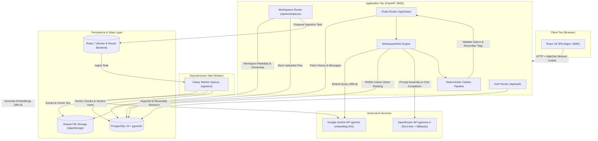
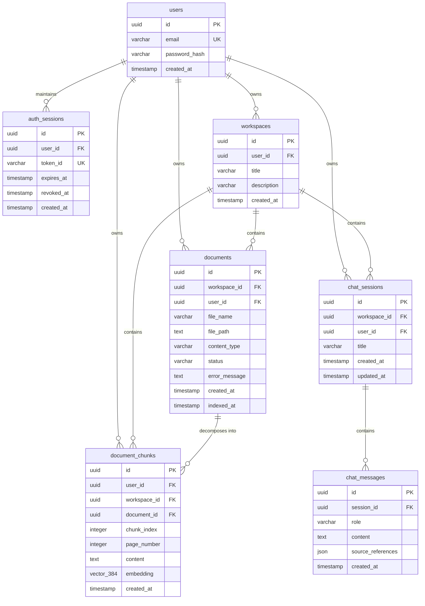

# Document Chatbot - Multi-Tenant Workspace RAG Platform

[](https://www.python.org/)
[](https://fastapi.tiangolo.com/)
[](https://react.dev/)
[](https://github.com/pgvector/pgvector)
[](https://redis.io/)
[](https://docs.celeryq.dev/)
[](https://www.docker.com/)
[](LICENSE)

> A production-oriented, multi-tenant Retrieval-Augmented Generation (RAG) platform.
> Upload complex PDF and DOCX files, organize knowledge into isolated workspaces, and chat with your documents using verifiable, sentence-grounded citations.

---

## 1. Project Overview and Description

Document Chatbot is a full-stack, enterprise-grade Knowledge Assistant designed to enable accurate, hallucination-free document question answering.
Users organize their work into separate workspaces, where each workspace serves as an isolated knowledge repository with its own documents, chat threads, and vector index partitions.
The platform bridges raw unstructured document files (PDF and DOCX) with state-of-the-art Large Language Models through an automated, asynchronous processing pipeline.

Instead of generic conversational summaries, the platform guarantees that every factual claim is tied directly to an auditable source passage.
Answers feature interactive citation tags (e.g., `[1]`, `[2]`) that correspond to cited source cards.
Clicking any citation reveals the exact page number, preview snippet, and highlighted passage from the original uploaded file.

---

## 2. Problems Solved and Key Objectives

### Problems Addressed
1. **LLM Hallucinations and Fabrications**:
   Standard language models generate convincing yet unverified claims when asked specific questions about proprietary documents.
   This system restricts answer generation strictly to facts present inside retrieved document context.
2. **Lack of Evidence Auditability**:
   Most RAG implementations return answers without indicating which specific sentence or page supported each fact.
   Document Chatbot enforces inline sentence citations and provides full passage inspection with highlighted evidence.
3. **Multi-Tenant Data Leakage**:
   Single-tenant or shared-index architectures risk cross-user information leakage.
   This platform enforces multi-tenant scoping at every layer, from relational metadata to pgvector distance queries.
4. **Synchronous Upload Bottlenecks**:
   Extracting, normalizing, chunking, and embedding large documents during an HTTP request causes connection timeouts and degraded performance.
   Document ingestion is offloaded to asynchronous background Celery workers with distributed Redis message queues.
5. **Provider Rate Limiting and API Fragility**:
   LLM and embedding providers often enforce strict Requests-Per-Minute (RPM) limits or experience transient downtime.
   The platform implements automatic retry mechanisms, dynamic backoff calculations based on provider quota responses, empty-response detection, and automated model fallbacks.

### Core Engineering Objectives
- **Strict Data Isolation**: Guarantee tenant isolation using composite foreign keys and explicit database filters across workspaces.
- **Deterministic Citation Verification**: Validate numerical claims and metrics against source text deterministically to eliminate misattributed citations.
- **Asynchronous Scalability**: Handle concurrent multi-file uploads seamlessly via Celery worker pools without blocking user interactions.
- **High-Performance Vector Retrieval**: Leverage PostgreSQL 16 with native `pgvector` HNSW cosine indexing for sub-second retrieval over tens of thousands of chunks.
- **Responsive, Clean UI/UX**: Provide an uncluttered ChatGPT-style interface built in React with dark-theme styling, accessible dialogs, and real-time indexing status feedback.

---

## 3. High-Level Design (HLD)

### System Architecture Diagram



### End-to-End Workflow

#### 1. Ingestion Pipeline
1. The user uploads PDF or DOCX files via the [`ResourcesPanel.js`](file:///home/shripad/Desktop/miniproject/ai-document-chatbot/frontend/src/components/resources/ResourcesPanel.js) drawer in the React web client.
2. The [`workspaces.py`](file:///home/shripad/Desktop/miniproject/ai-document-chatbot/backend/app/routers/workspaces.py) router verifies user ownership, checks file constraints (PDF/DOCX, max 25 MB per file), writes the files to persistent volume storage, inserts a database record with `status="processing"`, and enqueues a Celery task on Redis.
3. The background Celery worker picks up the job in [`tasks.py`](file:///home/shripad/Desktop/miniproject/ai-document-chatbot/backend/app/tasks.py).
4. The worker extracts text using PyMuPDF (PDF) or python-docx (DOCX) while recording physical page numbers.
5. Text is cleaned and split into semantic chunks (600 to 900 characters) preserving sentence boundaries and a 2-sentence overlap across chunk transitions.
6. Chunks are embedded in batches of 32 using Google GenAI `gemini-embedding-001` (384-dimensional vectors) with automatic rate-limit backoff.
7. The database replaces old chunks atomically in a single transaction, marks the document status as `indexed`, and records `indexed_at`.

#### 2. Query and Answer Generation Pipeline
1. The user sends a question in an active chat session.
2. The [`chats.py`](file:///home/shripad/Desktop/miniproject/ai-document-chatbot/backend/app/routers/chats.py) router saves the user message, updates the chat title if it is the first prompt, and fetches the last 10 historical conversation turns.
3. The query is embedded via `gemini-embedding-001` into a 384-dimensional vector.
4. An HNSW cosine distance search executes in PostgreSQL, filtered strictly by `user_id`, `workspace_id`, and `status="indexed"`, returning the top 8 most relevant chunks.
5. The retrieved chunks are assigned turn-local tags (`[chunk_1]`, `[chunk_2]`) and structured inside `<retrieved_context>` XML blocks.
6. The system prompt instructs the model to answer using only explicit facts from context, followed by the exact source tag.
7. OpenRouter generates the answer (default: `google/gemma-4-31b-it:free`, with automatic retry and model fallbacks).
8. The [`citation_pipeline.py`](file:///home/shripad/Desktop/miniproject/ai-document-chatbot/backend/app/services/citation_pipeline.py) service scans the answer, verifies quantitative claims, rebinds tags if necessary, renumbers citations sequentially (`[1]`, `[2]`), and extracts focused evidence snippets.
9. The final answer and structured references are stored in the database and delivered to the client.

---

## 4. Low-Level Design (LLD)

### Database Schema and Entity Relationships

The relational layer is managed by SQLAlchemy 2.0 with Alembic migrations on PostgreSQL 16.



### Table Specifications and Indexing
- **`users`**: Stores authenticated identities.
  Password hashes are generated using Argon2id.
  Emails are unique, stripped, and lowercased.
- **`auth_sessions`**: Tracks active login tokens.
  The `token_id` represents the unique JWT `jti` claim.
  Sessions can be revoked server-side immediately upon logout by populating `revoked_at`.
- **`workspaces`**: Organizes tenant context.
  Indexed on `(user_id, created_at)` for fast workspace listings.
- **`documents`**: Tracks uploaded source binaries stored on disk.
  Status is constrained to `processing`, `indexed`, or `failed`.
- **`document_chunks`**: Stores normalized text chunks and vector embeddings.
  Contains a composite index on `(user_id, workspace_id, document_id)`.
  Vector similarity search is accelerated by an HNSW index on `embedding` using `vector_cosine_ops` (`m = 16`, `ef_construction = 64`).
- **`chat_sessions`**: Groups message histories per workspace.
- **`chat_messages`**: Stores message turns (`user` or `assistant`), message text, and resolved citation metadata in JSON format.

### Sentence-Aligned Chunking Algorithm

Chunking is implemented in [`citation_pipeline.py`](file:///home/shripad/Desktop/miniproject/ai-document-chatbot/backend/app/services/citation_pipeline.py):
1. **Document Text Normalization**:
   Re-joins hyphenated line-wraps created by PDF extraction (e.g., `tempera-\nture` becomes `temperature`).
   Strips byte order marks (`\ufeff`) and normalizes non-breaking spaces.
2. **Heading Detection**:
   Identifies uppercase headings and numbered section titles so that headings stay glued to their following sentences rather than dangling at chunk ends.
3. **Punctuation and Abbreviation Awareness**:
   Splits text strictly at sentence boundaries (`.`, `!`, `?`).
   Ignores decimal points (`3.14`) and common abbreviations (`dr.`, `prof.`, `fig.`, `no.`, `e.g.`, `i.e.`, `u.s.`, `u.k.`).
4. **Length and Overlap Bounds**:
   Target chunk size is 600 to 900 characters.
   Sentences are accumulated until the upper boundary is reached.
   Single long sentences exceeding 900 characters are kept intact to avoid mid-sentence truncation.
   A 2-sentence overlap is carried over between successive chunks and across page transitions, ensuring seamless context across chunk boundaries.

### Deterministic Citation Pipeline

Implemented in [`citation_pipeline.py`](file:///home/shripad/Desktop/miniproject/ai-document-chatbot/backend/app/services/citation_pipeline.py#L222-L374):
1. **Tag Extraction**:
   Uses regex `r"\[(chunk_\d+)\]"` to detect all citations emitted by the LLM.
2. **Quantitative Claim Verification**:
   Extracts numbers, percentages, dates, and units (e.g., `15%`, `-1.5°C`, `24.5 km/h`) from the answer sentence preceding each citation tag.
   Verifies that the cited chunk explicitly contains these exact values.
   If the model hallucinated the citation tag, the pipeline searches the other retrieved chunks for exact quantity matches and rebinds the citation to the correct source chunk.
3. **Sequential Renumbering**:
   Replaces internal model tags with sequential user-facing indices `[1]`, `[2]`, `[3]` based on the order of first appearance in the text.
4. **Evidence Snippet Extraction**:
   Scores sentences inside the chunk based on token overlap with the user query and answer claim (with high weighting for numbers and metrics).
   Selects the best matching sentence as `highlight_text` and builds a focused contextual window (up to 480 characters) as `snippet`.

### LLM Client with Resilient Retries and Model Fallbacks

Implemented in [`openrouter.py`](file:///home/shripad/Desktop/miniproject/ai-document-chatbot/backend/app/services/openrouter.py):
- **Base Client**: Configured with the OpenAI-compatible OpenRouter API.
- **Retry Strategy**: Bounded exponential backoff (up to 2 retries, 0.75s to 6.0s) for connection drops, timeouts, and provider 5xx errors.
- **Empty-Response Detection**: Automatically detects 200 OK responses where completion tokens are empty or truncated.
  Sequentially switches to configured fallback models (`nvidia/nemotron-3.5-lightning:free`, `nvidia/nemotron-3-ultra-550b-a55b:free`) to retrieve a valid response.
- **Quota and Rate Limit Protection**: Parses `Retry-After` headers on HTTP 429 and fails fast without aggressive loops.
- **Sanitized Logging**: Redacts authorization keys and credentials from error logs.

---

## 5. Technology Stack

| Layer | Component | Description |
|---|---|---|
| **Backend Framework** | [FastAPI](https://fastapi.tiangolo.com/) | ASGI web framework with automatic OpenAPI documentation |
| **ASGI Server** | [Uvicorn](https://www.uvicorn.org/) | High-performance asynchronous Python web server |
| **ORM & Migrations** | [SQLAlchemy 2.0](https://www.sqlalchemy.org/) & [Alembic](https://alembic.sqlalchemy.org/) | Type-annotated declarative models with database versioning |
| **Relational & Vector Store** | [PostgreSQL 16](https://www.postgresql.org/) + [pgvector](https://github.com/pgvector/pgvector) | Relational database with native vector similarity search |
| **Task Queue & Broker** | [Celery 5.4](https://docs.celeryq.dev/) + [Redis 7](https://redis.io/) | Distributed background task runner for document ingestion |
| **Document Parsing** | [PyMuPDF](https://pymupdf.readthedocs.io/) & [python-docx](https://python-docx.readthedocs.io/) | High-speed PDF layout block extraction and DOCX parsing |
| **Embedding Generation** | [Google GenAI SDK](https://github.com/googleapis/python-genai) | `gemini-embedding-001` (384 dimensions, output dimensionality matched) |
| **Answer Generation** | [OpenRouter](https://openrouter.ai/) | Default: `google/gemma-4-31b-it:free` with Nemotron fallbacks |
| **Authentication** | [Argon2-cffi](https://argon2-cffi.readthedocs.io/) & [python-jose](https://github.com/mpdavis/python-jose) | Argon2id password hashing with signed JWT session tokens |
| **Frontend Framework** | [React 18](https://react.dev/) | Single Page Application created with React Scripts |
| **HTTP Client** | [Axios](https://axios-http.com/) | Configured with `withCredentials: true` and request timeouts |
| **Styling & Icons** | Custom Vanilla CSS & Custom SVG Icons | Pure CSS design system with zero third-party component library overhead |
| **Containerization** | [Docker](https://www.docker.com/) & [Docker Compose](https://docs.docker.com/compose/) | 5-container orchestration with persistent named volumes |

---

## 6. Active API Specification

All protected endpoints require an authenticated session via the `access_token` HttpOnly cookie or a `Bearer <token>` Authorization header.

| Method | Endpoint | Auth | Request Body | Status | Description |
|---|---|---|---|---|---|
| `POST` | `/api/auth/register` | Public | `Credentials` (`email`, `password`) | 201 | Register account, hash password, issue session cookie |
| `POST` | `/api/auth/login` | Public | `Credentials` (`email`, `password`) | 200 | Verify password, issue session cookie |
| `GET` | `/api/auth/me` | User | None | 200 | Return authenticated user details |
| `POST` | `/api/auth/logout` | User | None | 204 | Revoke server session and clear cookie |
| `GET` | `/api/workspaces` | User | None | 200 | List user workspaces ordered by creation date |
| `POST` | `/api/workspaces` | User | `WorkspaceCreate` (`title`, `description`) | 201 | Create a new isolated workspace |
| `PATCH` | `/api/workspaces/{id}` | User | `WorkspaceUpdate` (`title`, `description`) | 200 | Update workspace title or description |
| `DELETE` | `/api/workspaces/{id}` | User | None | 204 | Delete workspace, cascade deleting all documents and chats |
| `POST` | `/api/workspaces/{id}/documents` | User | `multipart/form-data` (`files`) | 202 | Upload up to 20 files (max 25 MB each) and enqueue Celery job |
| `GET` | `/api/workspaces/{id}/documents` | User | None | 200 | List documents in workspace with indexing statuses |
| `DELETE` | `/api/workspaces/{id}/documents/{doc_id}` | User | None | 204 | Delete document binary, database chunks, and vector embeddings |
| `GET` | `/api/workspaces/{id}/chats` | User | None | 200 | List chat threads in workspace |
| `POST` | `/api/workspaces/{id}/chats` | User | `ChatCreate` (`title`) | 201 | Create a new chat session |
| `GET` | `/api/chats/{id}/messages` | User | None | 200 | List all messages in chat session |
| `POST` | `/api/chats/{id}/messages` | User | `MessageCreate` (`content`) | 201 | Send question, execute RAG retrieval, return answer and citations |
| `GET` | `/api/health` | Public | None | 200 | Health check returning `{"status": "healthy"}` |
| `GET` | `/` | Public | None | 200 | Root endpoint with API title and link to OpenAPI docs |

---

## 7. Frontend Architecture and User Interface

The frontend is a React 18 single-page application located in [`frontend/`](file:///home/shripad/Desktop/miniproject/ai-document-chatbot/frontend).
It follows a clean modular design with zero third-party component library bloat:

```text
frontend/src/
├── components/
│   ├── auth/
│   │   └── AuthPage.js           # Authentication card (login and signup tabs)
│   ├── chat/
│   │   ├── ChatView.js           # Header breadcrumbs, message stack, and auto-growing composer
│   │   ├── MarkdownRenderer.js   # Custom Markdown parser with code blocks, tables, and citation pills
│   │   ├── MessageItem.js        # Message row for user and assistant with copy action
│   │   └── SourceCards.js        # Cited passage cards and full passage modal inspector
│   ├── layout/
│   │   └── Sidebar.js            # Workspace list, active chat list with search filter, and logout
│   ├── resources/
│   │   └── ResourcesPanel.js     # Slide-over document management drawer with drag-and-drop zone
│   └── ui/
│       ├── ConfirmDialog.js      # Modal for confirming destructive deletions
│       ├── Icons.js              # Inline SVG icons and brand artwork
│       ├── Modal.js              # Accessible modal dialog with focus management
│       ├── Skeleton.js           # Loading skeletons for lists
│       ├── Toast.js              # Notification feedback toasts
│       └── WorkspaceModal.js     # Modal for creating and renaming workspaces
├── App.js                        # Root controller, state management, and custom URL routing
├── api.js                        # Axios instance with credentials and standardized error extraction
├── App.css                       # Design tokens, color system, and component styles
└── index.css                     # Global reset and typography smoothing
```

### Key UI Features
- **Grounding and Index Status**: The chat header displays live counters for ready documents and currently indexing documents.
- **Thinking Card**: While the assistant is synthesizing a response, an animated indicator displays the current pipeline step (`Searching vector index…`, `Retrieving relevant document chunks…`, `Synthesizing grounded answer…`).
- **Interactive Citation Pills**: Clicking or hovering any citation pill (`[1]`, `[2]`) in the assistant's message scrolls to and highlights the corresponding source card.
- **Source Inspector Modal**: Clicking a source card opens a modal displaying the entire chunk passage with exact evidence sentences highlighted in yellow `<mark>` tags.
- **Client-Side Chat Search**: Filter active workspace chat sessions instantly through a responsive search input in the sidebar.

---

## 8. Local Setup and Deployment Guide

### Prerequisites
- Docker Engine 24+ and Docker Compose v2.
- A Google AI Studio API Key for embeddings ([Get a key](https://aistudio.google.com/apikey)).
- An OpenRouter API Key for answer generation ([Get a key](https://openrouter.ai/keys)).

### Quickstart (Docker Compose)
1. Clone the repository:
   ```bash
   git clone https://github.com/your-username/ai-document-chatbot.git
   cd ai-document-chatbot
   ```

2. Configure environment variables:
   ```bash
   cp backend/.env.example backend/.env
   ```
   Open `backend/.env` and add your API keys:
   ```env
   GOOGLE_API_KEY=your-google-ai-studio-key
   OPENROUTER_API_KEY=your-openrouter-key
   ```

3. Launch the platform using the restart script:
   ```bash
   chmod +x restart_project.sh
   ./restart_project.sh
   ```

4. Open your browser:
   - Web Application: **http://localhost:8080**
   - Backend API Docs (Swagger): **http://localhost:8000/docs**

### Environment Configuration Reference

| Variable | Default Value | Description |
|---|---|---|
| `DATABASE_URL` | `postgresql+psycopg://rag:local-dev-password@db:5432/document_chatbot` | PostgreSQL connection string |
| `REDIS_URL` | `redis://redis:6379/0` | Redis broker and backend URL for Celery |
| `JWT_SECRET_KEY` | `local-development-secret-change-before-deploy` | Cryptographic key used to sign JWT session cookies |
| `ACCESS_TOKEN_HOURS` | `12` | Session duration in hours before re-authentication |
| `UPLOAD_DIR` | `/app/storage` | Root directory for uploaded documents inside containers |
| `MAX_UPLOAD_BYTES` | `26214400` (25 MB) | Maximum permitted size per file upload |
| `FRONTEND_ORIGIN` | `http://localhost:8080` | Allowed CORS origin |
| `COOKIE_SECURE` | `false` | Set to `true` when serving over HTTPS in production |
| `GOOGLE_API_KEY` | None (Required) | API key for Gemini embeddings |
| `OPENROUTER_API_KEY` | None (Required) | API key for OpenRouter chat completions |
| `OPENROUTER_MODEL` | `google/gemma-4-31b-it:free` | Primary LLM model identifier |
| `OPENROUTER_FALLBACK_MODELS` | `nvidia/nemotron-3.5-lightning:free,nvidia/nemotron-3-ultra-550b-a55b:free` | Fallback models for rate limit mitigation |
| `LOG_COLOR` | `true` | Enables ANSI level colors in server logs |
| `LOG_LEVEL` | `INFO` | Python logging verbosity |

---

## 9. Testing and Maintenance

### Running Backend Tests
Execute pytest with the Python path configured to `backend`:
```bash
PYTHONPATH=backend pytest backend/tests
```
Tests verify text normalization, sentence splitting, citation tag resolution, quantity validation, and OpenRouter retry/fallback handling.

### Running Frontend Tests
Execute Jest tests in the frontend directory:
```bash
npm --prefix frontend test -- --watchAll=false
```
Tests verify custom Markdown rendering, table parsing, citation pill detection, and source card inspection.

### Document Re-Indexing CLI
When altering chunk sizes or embedding models, all existing documents can be reprocessed without manual re-upload:
```bash
# Inside the backend container or virtual environment:
python -m app.reindex_documents --all

# Or for a specific document UUID:
python -m app.reindex_documents --document-id <document-uuid>
```

---

## 10. Security and Production Hardening

- **Credential Separation**: Secrets (`GOOGLE_API_KEY`, `OPENROUTER_API_KEY`, `JWT_SECRET_KEY`) reside only in environment variables and are excluded from git.
- **Cookie-Based Authentication**: JWTs are transmitted in `HttpOnly`, `SameSite=Lax` cookies, preventing cross-site scripting (XSS) credential theft.
- **Tenant Authorization Checks**: Every database operation verifies that the requested resource belongs to `current_user.id`.
- **Durable File Scrubbing**: Deleting a document or workspace deletes the database records, removes chunks from the pgvector index, and unlinks binary files from disk storage.
- **Untrusted Context Isolation**: Retrieved document text is encapsulated within explicit `<retrieved_context>` XML delimiters in prompts to prevent prompt injection from malicious uploaded files.

---

## 11. License

This project is licensed under the **MIT License**.
See the [LICENSE](LICENSE) file for complete details.
