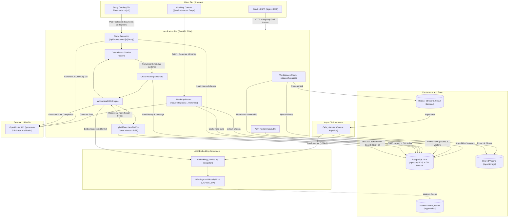
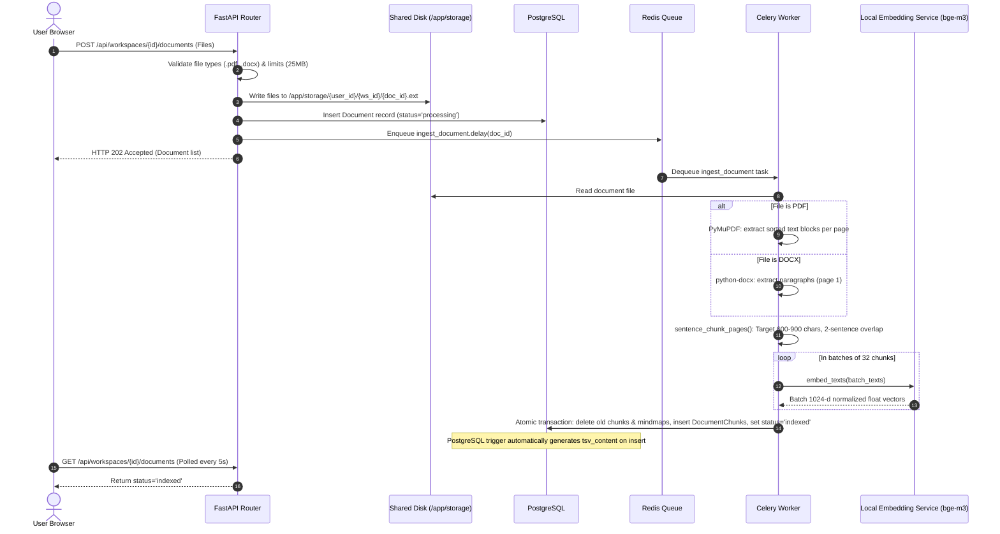

# Repository Context - Document Chatbot Workspace Platform

## 1. Executive Summary and Architecture Overview

Document Chatbot is a production-oriented, multi-tenant Retrieval-Augmented Generation (RAG) platform.
It allows authenticated users to create isolated workspaces, upload documents (PDF and DOCX), and converse with their document contents through verifiable citations.
The repository represents a transition from an initial single-user prototype to a multi-tenant workspace architecture.
The v1 architecture used local ChromaDB vector storage, in-memory conversation dictionaries, and unauthenticated endpoints.
The v2 architecture runs on PostgreSQL 16 with pgvector and full-text search, Celery background workers backed by Redis, Argon2id authentication with revocable session tokens, local `BAAI/bge-m3` 1024-dimensional dense vector embeddings, OpenRouter chat completions with model fallbacks, interactive hierarchical mind map visualization, stateless citation-backed study set generation, and deterministic sentence-aligned citation verification.

### Key Architectural Capabilities

1. **Local BAAI/bge-m3 Dense Embeddings**:
All embedding generation for document chunks and user search queries runs locally using `BAAI/bge-m3` via `sentence-transformers` and PyTorch.
This completely eliminates external API rate limits (HTTP 429), quota exhaustion delays, and recurring retry storms during document ingestion.
Dense embeddings produce 1024-dimensional L2-normalized vectors indexed by PostgreSQL `pgvector` HNSW cosine similarity.

2. **Hybrid Retrieval with Reciprocal Rank Fusion (RRF)**:
The platform combines lexical BM25 full-text keyword search (via PostgreSQL `tsvector`, GIN indexing, and `ts_rank`) with dense semantic vector search (via `pgvector` HNSW cosine similarity on 1024-d vectors).
Candidate pools from both searchers (up to 20 candidates each) are fused and re-ranked using Reciprocal Rank Fusion ($k=60$), ensuring precise keyword matches and broad semantic discovery.
The retrieval mode is configurable dynamically via `RETRIEVAL_MODE` (`hybrid_rrf`, `cosine_baseline`, or `bm25_only`).

3. **Interactive Hierarchical Mind Maps**:
Users can generate NotebookLM-style interactive mind maps for any indexed document.
The backend extracts structured JSON trees using OpenRouter, and the frontend renders an interactive graph canvas using `@xyflow/react` and `@dagrejs/dagre`.
Clicking any mind map node instantly triggers grounded RAG exploration in the workspace chat.

4. **Deterministic Citation Verification**:
Assistant answers feature sequential inline citation markers (`[1]`, `[2]`).
The citation pipeline verifies quantitative claims against source passages, rebinds misattributed tags, and extracts focused evidence snippets.
Clicking any source card opens a full passage inspector modal highlighting matching sentences in archival amber.

5. **Hardened Ingestion Pipeline**:
Document parsing and chunking are offloaded to Celery workers on Redis.
The worker utilizes local batch embedding (`embed_texts`) with atomic transactions that swap old chunks for new chunks and mind maps in a single database commit.
The PostgreSQL column `tsv_content` is defined with `server_default=sa.FetchedValue()`, omitting it from ORM insert parameter lists and allowing the PostgreSQL trigger `trg_document_chunks_tsv_update` to compute `tsvector` automatically without datatype mismatch errors.

6. **Stateless Study Mode**:
Users can generate citation-backed flashcards or multiple-choice quizzes from selected indexed workspace documents.
The backend samples about 20,000 characters across documents, asks OpenRouter for a JSON study set with reasoning disabled, repairs and validates the JSON, and resolves every citation against the sampled chunks.
Study generation persists nothing, requires no migration, and returns `StudySetOut` directly to the frontend overlay.
Items that cannot resolve at least one citation are dropped, so generated sets remain grounded.

7. **Architectural Design System**:
The UI features a disciplined cold graphite palette (`#0B0E14`), Steel Cerulean accent (`#38BDF8`), archival amber evidence highlighters, and Geist / Geist Mono typography.

### System Architecture Diagram



---

## 2. Directory Tree and File Inventory

```text
ai-document-chatbot/
├── backend/
│   ├── alembic/
│   │   ├── env.py                                # Alembic environment configuration
│   │   └── versions/
│   │       ├── 0001_workspace_platform.py        # Initial PostgreSQL + pgvector schema migration
│   │       ├── 0002_document_mindmap.py          # Migration creating document_mindmaps table
│   │       ├── 0002_add_bm25_tsvector.py         # Migration adding tsv_content, GIN index, and trigger
│   │       └── 0003_vector_dim_1024.py          # Migration expanding embedding to 1024-d for BAAI/bge-m3
│   ├── alembic.ini                               # Alembic CLI database configuration
│   ├── app/
│   │   ├── models/
│   │   │   ├── __init__.py                       # Models package export
│   │   │   ├── entities.py                       # SQLAlchemy ORM models (User, LoginSession, Workspace, Document, DocumentChunk, DocumentMindMap, ChatSession, ChatMessage)
│   │   │   └── schemas.py                        # Pydantic v2 validation and response models (including MindMapNodeSchema, MindMapOut, StudyGenerateRequest, and StudySetOut)
│   │   ├── routers/
│   │   │   ├── __init__.py                       # Active routers export (auth, chats, mindmap, workspaces)
│   │   │   ├── auth.py                           # Authentication routes (/api/auth: register, login, me, logout)
│   │   │   ├── chats.py                          # Chat routes (/api/chats/{id}/messages and DELETE /api/chats/{id})
│   │   │   ├── mindmap.py                        # Document mind map routes (/api/workspaces/{id}/documents/{doc_id}/mindmap)
│   │   │   ├── workspaces.py                     # Workspace CRUD, document ingestion, and stateless study generation routes (/api/workspaces)
│   │   │   ├── chat.py                           # [LEGACY v1] In-memory single-user chat endpoint (not mounted in main.py)
│   │   │   └── documents.py                      # [LEGACY v1] Direct synchronous upload endpoint (not mounted in main.py)
│   │   ├── services/
│   │   │   ├── __init__.py                       # Services package export (HybridSearcher, embedding_service, etc.)
│   │   │   ├── citation_pipeline.py              # Sentence splitter, chunker, context formatter, citation resolver, and snippet extractor
│   │   │   ├── embedding_service.py              # Local BAAI/bge-m3 singleton embedding service (embed_texts, embed_query)
│   │   │   ├── hybrid_search.py                  # BM25Searcher, DenseVectorSearcher, reciprocal_rank_fusion, and HybridSearcher
│   │   │   ├── mindmap_generator.py              # Hierarchical mind map tree generation using Gemini API with OpenRouter fallback
│   │   │   ├── openrouter.py                     # OpenRouter API client with retries, empty-response detection, and model fallbacks
│   │   │   ├── study_generator.py                # Stateless sampling, JSON study set generation, validation, and citation resolution
│   │   │   ├── workspace_rag.py                  # Core RAG orchestration: query embedding, hybrid retrieval, prompt assembly, and citation linking
│   │   │   ├── document_processor.py             # [LEGACY v1] ChromaDB-based ingestion processor
│   │   │   └── rag_service.py                    # [LEGACY v1] ChromaDB-based query service
│   │   ├── auth.py                               # JWT token issuance, verification, and get_current_user FastAPI dependency
│   │   ├── config.py                             # Central application configuration loaded from environment variables
│   │   ├── db.py                                 # SQLAlchemy database engine and sessionmaker dependency
│   │   ├── evaluate_retrieval.py                 # Retrieval evaluation benchmark CLI (Recall@K, MRR, NDCG@K, Latency)
│   │   ├── logging_config.py                     # Structured ANSI-colorized stdout log formatter
│   │   ├── main.py                               # FastAPI application entrypoint and router registration
│   │   ├── queue.py                              # Celery application configuration and task routing
│   │   ├── reindex_documents.py                  # CLI utility to reprocess and re-embed documents
│   │   └── tasks.py                              # Celery asynchronous task definitions (ingest_document with local bge-m3 batching)
│   ├── scripts/
│   │   └── download_model.py                     # Pre-download utility for BAAI/bge-m3 model weights
│   ├── tests/
│   │   ├── test_citation_pipeline.py             # Unit tests for text normalization, chunking, and citation mapping
│   │   ├── test_embedding_service.py             # Unit tests for bge-m3 embedding service, dimensions, and tsv_content omission
│   │   ├── test_hybrid_search.py                 # Unit tests for BM25 search, dense vector search, and RRF fusion
│   │   ├── test_mindmap.py                       # Unit tests for mind map generator parsing, structure, and fallbacks
│   │   ├── test_openrouter_generation.py         # Unit tests for OpenRouter error handling, retries, and fallbacks
│   │   └── test_study_generator.py               # Unit tests for study sampling, request validation, JSON repair, item validation, and citations
│   ├── .env.example                              # Template for backend secrets and configuration
│   ├── Dockerfile                                # Multi-stage backend container definition with CPU PyTorch
│   ├── requirements.txt                          # Production Python dependencies (including sentence-transformers & torch)
│   ├── requirements-dev.txt                      # Development Python dependencies (pytest)
│   └── start_backend.sh                          # Local direct startup script
├── frontend/
│   ├── public/
│   │   └── index.html                            # HTML entrypoint, title, and font imports (Geist & Geist Mono)
│   ├── src/
│   │   ├── components/
│   │   │   ├── auth/
│   │   │   │   └── AuthPage.js                   # Unified login and signup form with client validation
│   │   │   ├── chat/
│   │   │   │   ├── ChatView.js                   # Main chat container, header, message list, ThinkingCard, and composer
│   │   │   │   ├── MarkdownRenderer.js           # Custom parser for Markdown (headings, code blocks, tables, lists) and citation pills
│   │   │   │   ├── MarkdownRenderer.test.js      # Unit tests for Markdown parsing and citation pill detection
│   │   │   │   ├── MessageItem.js                # Individual message bubble rendering user/assistant content
│   │   │   │   ├── SourceCards.js                # Grid of cited passage cards and detailed citation inspector modal
│   │   │   │   └── SourceCards.test.js           # Unit tests for SourceCards rendering and selection
│   │   │   ├── layout/
│   │   │   │   └── Sidebar.js                    # Workspace list, active chat list with search filter, copy/delete chat actions, brand home, and user session footer
│   │   │   ├── mindmap/
│   │   │   │   ├── MindMapNode.js                # Custom React Flow node supporting click-to-expand/collapse, toggle badge, and leaf RAG queries
│   │   │   │   ├── MindMapNode.test.js           # Unit tests for MindMapNode click interactions, multi-level hierarchy, and query triggers
│   │   │   │   ├── MindMapOverlay.js             # Full-screen mind map canvas overlay with floating controls and PNG export
│   │   │   │   ├── useMindMapLayout.js           # Custom hook calculating Dagre hierarchical layout and branch collapse state
│   │   │   │   └── useMindMapLayout.test.js      # Unit tests for mind map layout calculation
│   │   │   ├── resources/
│   │   │   │   └── ResourcesPanel.js             # Slide-over drawer for drag-and-drop document upload and mind map launch
│   │   │   ├── study/
│   │   │   │   ├── StudyOverlay.js               # Stateless flashcards and quiz overlay with configuration, loading, citations, and review
│   │   │   │   └── StudyOverlay.test.js          # Unit tests for mode switching, document defaults, flashcard flip, quiz feedback, and close
│   │   │   └── ui/
│   │   │       ├── ConfirmDialog.js              # Generic destructive confirmation modal (delete workspace/document)
│   │   │       ├── Icons.js                      # Custom SVG icons, brand logos, avatar badges, and file type logos
│   │   │       ├── Modal.js                      # Accessible modal dialog container with keyboard trap
│   │   │       ├── Skeleton.js                   # Skeleton loading placeholders for sidebar lists
│   │   │       ├── Toast.js                      # Notification toast popup for feedback and errors
│   │   │       └── WorkspaceModal.js             # Modal for creating or renaming workspaces
│   │   ├── App.css                               # Architectural component, layout, and interaction styles
│   │   ├── App.js                                # Top-level frontend controller, routing, session bootstrap, and workspace state
│   │   ├── api.js                                # Axios client instance configured with credentials, error parsing, and study generation
│   │   ├── index.css                             # Global CSS reset, font imports, and typography utilities
│   │   └── index.js                              # React DOM mounting entrypoint
│   ├── Dockerfile                                # Frontend container with multi-stage build and Nginx
│   ├── nginx.conf                                # Nginx web server configuration with SPA fallback
│   ├── package.json                              # Node dependencies and build scripts
│   └── start_frontend.sh                         # Local frontend startup script
├── docs/                                         # Screenshots and product assets
├── docker-compose.yml                            # Multi-container orchestration (db, redis, backend, worker, frontend, model_cache)
├── restart_project.sh                            # Canonical script to rebuild and start the entire Docker stack
├── deploy.sh                                     # Production deployment preparation script
├── ADMIN_GUIDE.md                                # Operational administration documentation
├── AGENTS.md                                     # Mandatory synchronization instructions for AI agents
├── CONFIGURATION.md                              # Configuration reference and environment variable details
├── DEPLOYMENT.md                                 # Production deployment guide
├── DESIGN.md                                     # Precision design system, color tokens, and architectural guidelines
├── ENVIRONMENT.md                                # Environment specification
├── FRONTEND_CONTEXT.txt                          # Comprehensive UI/UX design and interaction documentation
├── GEMINI.md                                     # Gemini/agent rules and context synchronization guidelines
├── IMPLEMENTATION_PLAN.md                        # Implementation plan for local BAAI/bge-m3 migration and pipeline hardening
├── LOGGING.md                                    # Logging standards and operational monitoring guide
├── PLATFORM_ARCHITECTURE.md                      # High-level architecture summary
├── REPO_CONTEXT.md                               # Authoritative repository context and architectural reference
└── README.md                                     # Project overview and quickstart guide
```

---

## 3. Technology Stack and Dependencies

### Backend Dependencies (`requirements.txt`)
- **FastAPI** (`>=0.115,<1`): High-performance ASGI web framework.
- **Uvicorn** (`>=0.30,<1`): Production ASGI server.
- **SQLAlchemy** (`>=2.0.35,<3`): Modern Python ORM utilizing type-annotated Declarative mappings.
- **psycopg** (`>=3.2,<4`): Modern PostgreSQL driver with binary C extensions.
- **pgvector** (`>=0.3.5,<1`): PostgreSQL extension providing native vector operations and HNSW indexing.
- **sentence-transformers** (`>=3.3,<4`): Hugging Face sentence embedding library managing `BAAI/bge-m3`.
- **torch** (`>=2.4,<3`): PyTorch deep learning framework for local tensor inference (CPU/CUDA).
- **PostgreSQL Full-Text Search**: Native `tsvector`, `websearch_to_tsquery`, and `ts_rank` with GIN indexing for lexical BM25 matching.
- **Alembic** (`>=1.14,<2`): Relational database migration management.
- **Argon2-cffi** (`>=23.1,<26`): Password hashing using the Argon2id standard.
- **python-jose** (`>=3.3,<4`): Cryptographic signing and decoding of JSON Web Tokens.
- **Celery** (`>=5.4,<6`): Distributed asynchronous background task queue with Redis broker.
- **PyMuPDF / fitz** (`>=1.24,<2`): High-speed PDF text and structural block extraction.
- **python-docx** (`>=1.1,<2`): DOCX document parsing and paragraph extraction.
- **google-genai** (`>=2.3,<3`): Official Google GenAI SDK used optionally for Gemini mind map generation.
- **openai** (`>=1.58,<3`): Official OpenAI client repurposed to query OpenRouter chat completion APIs.
- **pydantic** (`>=2.8,<3`): Data validation and serialization models.
- **python-multipart** (`>=0.0.9`): Form data and file upload parsing for FastAPI.

### Frontend Dependencies (`package.json`)
- **React** (`^18.2.0`) & **React-DOM** (`^18.2.0`): Declarative UI library.
- **react-scripts** (`5.0.1`): Build and development tooling.
- **Axios** (`^1.6.2`): HTTP client with interceptors, credentials support, and extended timeouts.
- **@xyflow/react** (`^12.12.1`): Interactive flow and mind map visualization canvas with custom nodes and edges.
- **@dagrejs/dagre** (`^3.1.3`): Directed graph hierarchical layout algorithm used for auto-positioning mind map trees.
- **html-to-image** (`^1.11.13`): Client-side PNG image export for mind map canvas snapshots.

---

## 4. Database Schema and Entity Relationships

The relational database is PostgreSQL 16 with both `pgvector` and full-text search extensions enabled.
Schema definitions reside in [`entities.py`](file:///home/shripad/Desktop/miniproject/ai-document-chatbot/backend/app/models/entities.py).

### Entity-Relationship Diagram

```mermaid
erDiagram
    users ||--o{ auth_sessions : "has sessions"
    users ||--o{ workspaces : "owns"
    users ||--o{ documents : "owns"
    users ||--o{ document_chunks : "owns"
    users ||--o{ document_mindmaps : "owns"
    users ||--o{ chat_sessions : "owns"
    workspaces ||--o{ documents : "contains"
    workspaces ||--o{ document_chunks : "contains"
    workspaces ||--o{ document_mindmaps : "contains"
    workspaces ||--o{ chat_sessions : "contains"
    documents ||--o{ document_chunks : "splits into"
    documents ||--o| document_mindmaps : "has mindmap"
    chat_sessions ||--o{ chat_messages : "records"

    users {
        uuid id PK
        varchar email UK
        varchar password_hash
        timestamp created_at
    }

    auth_sessions {
        uuid id PK
        uuid user_id FK
        varchar token_id UK
        timestamp expires_at
        timestamp revoked_at
        timestamp created_at
    }

    workspaces {
        uuid id PK
        uuid user_id FK
        varchar title
        varchar description
        timestamp created_at
    }

    documents {
        uuid id PK
        uuid workspace_id FK
        uuid user_id FK
        varchar file_name
        text file_path
        varchar content_type
        varchar status
        text error_message
        timestamp created_at
        timestamp indexed_at
    }

    document_chunks {
        uuid id PK
        uuid user_id FK
        uuid workspace_id FK
        uuid document_id FK
        integer chunk_index
        integer page_number
        text content
        vector_1024 embedding
        tsvector tsv_content
        timestamp created_at
    }

    document_mindmaps {
        uuid id PK
        uuid document_id FK, UK
        uuid user_id FK
        uuid workspace_id FK
        json tree_data
        timestamp created_at
        timestamp updated_at
    }

    chat_sessions {
        uuid id PK
        uuid workspace_id FK
        uuid user_id FK
        varchar title
        timestamp created_at
        timestamp updated_at
    }

    chat_messages {
        uuid id PK
        uuid session_id FK
        varchar role
        text content
        json source_references
        timestamp created_at
    }
```



### Table Definitions and Constraints

1. `users` Table:
   - Primary Key: `id` (`Uuid`, default `uuid.uuid4`).
   - `email`: `String(320)`, unique index, normalized to lower case.
   - `password_hash`: `String(255)`, Argon2id hash.
   - `created_at`: UTC timestamp with timezone.
   - Cascade delete propagates to `workspaces` and `auth_sessions`.

2. `auth_sessions` Table:
   - Primary Key: `id` (`Uuid`).
   - `user_id`: Foreign key referencing `users.id` with `ondelete="CASCADE"`.
   - `token_id`: `String(64)`, unique index, represents the JWT `jti` claim.
   - `expires_at`: UTC timestamp with timezone, indexed.
   - `revoked_at`: Nullable UTC timestamp; set when a user logs out to invalidate the session immediately.

3. `workspaces` Table:
   - Primary Key: `id` (`Uuid`).
   - `user_id`: Foreign key referencing `users.id` with `ondelete="CASCADE"`.
   - `title`: `String(160)`.
   - `description`: `String(1000)`.
   - Composite index: `ix_workspaces_user_created` on `(user_id, created_at)`.
   - Cascade delete propagates to `documents`, `document_chunks`, `document_mindmaps`, and `chat_sessions`.

4. `documents` Table:
   - Primary Key: `id` (`Uuid`).
   - `workspace_id`: Foreign key referencing `workspaces.id` with `ondelete="CASCADE"`.
   - `user_id`: Foreign key referencing `users.id` with `ondelete="CASCADE"`.
   - `file_name`: `String(255)` preserving the original uploaded file name.
   - `file_path`: `Text` pointing to disk storage in `/app/storage/<user_id>/<workspace_id>/<document_id><ext>`.
   - `content_type`: `String(120)`.
   - `status`: `String(20)` constrained to `processing`, `indexed`, or `failed` via check constraint `ck_documents_status`.
   - `error_message`: Nullable `Text` containing sanitized failure diagnostics.
   - `indexed_at`: Nullable UTC timestamp set when chunk extraction and vector embedding finish.

5. `document_chunks` Table:
   - Primary Key: `id` (`Uuid`).
   - `user_id`, `workspace_id`, `document_id`: Foreign keys ensuring tenant isolation with cascade deletion.
   - `chunk_index`: `Integer` ordering chunks within a document.
   - `page_number`: Nullable `Integer` recording primary physical page number.
   - `content`: `Text` representing normalized sentence-aligned passage content.
   - `embedding`: `Vector(1024)` storing 1024-dimensional BAAI/bge-m3 dense vector.
   - `tsv_content`: `tsvector` generated and maintained automatically by trigger `trg_document_chunks_tsv_update` from `to_tsvector('english', coalesce(content, ''))`.
   Mapped with `TSVectorType` and `server_default=sa.FetchedValue()` so SQLAlchemy never includes it in `INSERT` parameter lists.
   - Composite tenant index: `ix_chunks_tenant_scope` on `(user_id, workspace_id, document_id)`.
   - HNSW Vector Index: `ix_chunks_embedding_hnsw` on `embedding` using `vector_cosine_ops` with parameters `m = 16` and `ef_construction = 64`.
   - Full-Text GIN Index: `ix_chunks_tsv_content_gin` on `tsv_content` using GIN index.

6. `document_mindmaps` Table:
   - Primary Key: `id` (`Uuid`).
   - `document_id`: Foreign key referencing `documents.id` with `ondelete="CASCADE"`, unique.
   - `user_id`: Foreign key referencing `users.id` with `ondelete="CASCADE"`.
   - `workspace_id`: Foreign key referencing `workspaces.id` with `ondelete="CASCADE"`.
   - `tree_data`: `JSON` containing the recursive hierarchical mind map tree (`id`, `label`, `query`, `children`).
   - `created_at`, `updated_at`: UTC timestamps with timezone.
   - Indices: `ix_mindmaps_tenant_scope` on `(user_id, workspace_id, document_id)`, `ix_document_mindmaps_user_id`, and `ix_document_mindmaps_workspace_id`.

7. `chat_sessions` Table:
   - Primary Key: `id` (`Uuid`).
   - `workspace_id`, `user_id`: Foreign keys with cascade deletion.
   - `title`: `String(180)`, defaults to `New chat`, updated to the first 72 characters of the initial user query.
   - `updated_at`: UTC timestamp updated on new message insertion.

8. `chat_messages` Table:
   - Primary Key: `id` (`Uuid`).
   - `session_id`: Foreign key referencing `chat_sessions.id` with `ondelete="CASCADE"`.
   - `role`: Constrained to `user` or `assistant` via `ck_chat_messages_role`.
   - `content`: `Text` of message body.
   - `source_references`: `JSON` array of resolved citation dictionaries.

---

## 5. Authentication and Authorization Flow

Authentication logic is defined across [`auth.py`](file:///home/shripad/Desktop/miniproject/ai-document-chatbot/backend/app/auth.py) and [`routers/auth.py`](file:///home/shripad/Desktop/miniproject/ai-document-chatbot/backend/app/routers/auth.py).

### Core Mechanics
1. **Password Hashing**: Argon2id via `argon2.PasswordHasher()`.
When users log in, `check_needs_rehash` detects if parameters require updating.
2. **Session Creation**:
   - `issue_session(db, user)` generates a unique hexadecimal `token_id`.
   - A JWT is signed using `HS256` with claims `{"sub": str(user.id), "jti": token_id, "iat": now, "exp": expires_at}`.
   - An active record is committed to `auth_sessions`.
   - The token is placed into an `HttpOnly`, `SameSite=Lax` cookie named `access_token` with an expiration duration controlled by `ACCESS_TOKEN_HOURS` (default 12 hours).
3. **Session Verification (`get_current_user`)**:
   - Reads the cookie `access_token` or parses a `Bearer <token>` header from the `Authorization` header.
   - Decodes and verifies the JWT signature against `JWT_SECRET_KEY`.
   - Performs a database lookup in `auth_sessions` checking that `token_id` matches, `user_id` matches, `revoked_at` is null, and `expires_at > now`.
   - Loads the `User` record and attaches the active `LoginSession` to `request.state.auth_session`.
   - Rejects unauthenticated or revoked requests with HTTP 401.
4. **Logout**:
   - Sets `revoked_at` to the current UTC timestamp on the database session record.
   - Deletes the `access_token` browser cookie.

---

## 6. Document Ingestion and Celery Background Worker

Document ingestion is handled asynchronously using Celery and Redis with high-throughput local `BAAI/bge-m3` batch embeddings.

### Ingestion Flow Diagram



### Ingestion Details and Algorithms

1. **Upload Constraints**:
   - Max 20 files per upload batch (`MAX_FILES_PER_UPLOAD`).
   - Supported extensions: `.pdf`, `.docx` (`ALLOWED_EXTENSIONS`).
   - Max size per file: 25 MB (`MAX_UPLOAD_BYTES`).
2. **Text Extraction**:
   - Implemented in [`parse_pages()`](file:///home/shripad/Desktop/miniproject/ai-document-chatbot/backend/app/tasks.py#L21-L41).
   - PDF: Uses `pymupdf.open()`, extracts sorted layout blocks `page.get_text("blocks", sort=True)`, joins non-empty text blocks with double newlines.
   - DOCX: Uses `docx.Document()`, joins non-empty paragraphs into a single page unit (assigned page number 1).
3. **Sentence-Aligned Chunking**:
   - Implemented in [`chunk_pages()`](file:///home/shripad/Desktop/miniproject/ai-document-chatbot/backend/app/services/citation_pipeline.py#L121-L202).
   - Normalization: Re-joins words split across line-breaks with hyphens (e.g., `tempera-\nture` -> `temperature`), strips BOM markers, standardizes whitespace.
   - Heading Detection: Automatically recognizes uppercase titles and numbered headings to avoid splitting them across chunks.
   - Sentence Splitting: Splits text using regex while respecting common abbreviations (`dr.`, `fig.`, `e.g.`, `i.e.`, `u.s.`), decimals (`1.5`), and author initials.
   - Chunk Assembly: Targets 600 to 900 characters per chunk.
   Chunks never split sentences mid-way unless an individual sentence exceeds 900 characters.
   Maintains a sliding overlap of up to 2 complete sentences between successive chunks and across page boundaries.
   The chunk retains the page number of the first novel sentence introduced.
4. **Local Vector Embedding**:
   - Batches chunks in groups of 32 (configurable via `EMBEDDING_BATCH_SIZE`).
   - Calls [`embedding_service.embed_texts()`](file:///home/shripad/Desktop/miniproject/ai-document-chatbot/backend/app/services/embedding_service.py) on local `BAAI/bge-m3`.
   - Embeddings are 1024-dimensional floating point vectors normalized with L2 unit norm.
   - Operates entirely locally on CPU or CUDA GPU, eliminating external rate limits, network timeouts, and quota sleeps.
5. **Atomic Swap & Datatype Safety**:
   - Existing chunks and cached mind maps for the document are deleted only after all replacement embeddings have been computed.
   - Full-text search `tsv_content` is automatically populated by PostgreSQL trigger `trg_document_chunks_tsv_update` upon chunk insertion.
   - If an unrecoverable error occurs, the document status is updated to `failed`, recording a sanitized error message in `documents.error_message`.
   - Celery retries transient worker or database disconnects up to 2 times (`max_retries=2`) with a 10-second countdown delay.

---

## 7. Hybrid Search, RAG Retrieval, Citation Pipeline, and Generation

The RAG querying workflow is orchestrated across [`workspace_rag.py`](file:///home/shripad/Desktop/miniproject/ai-document-chatbot/backend/app/services/workspace_rag.py), [`embedding_service.py`](file:///home/shripad/Desktop/miniproject/ai-document-chatbot/backend/app/services/embedding_service.py), [`hybrid_search.py`](file:///home/shripad/Desktop/miniproject/ai-document-chatbot/backend/app/services/hybrid_search.py), [`citation_pipeline.py`](file:///home/shripad/Desktop/miniproject/ai-document-chatbot/backend/app/services/citation_pipeline.py), and [`openrouter.py`](file:///home/shripad/Desktop/miniproject/ai-document-chatbot/backend/app/services/openrouter.py).

### Retrieval Flow and Hybrid Architecture

1. **User Message Ingestion**:
   - User posts question to `POST /api/chats/{chat_id}/messages`.
   - System persists the user `ChatMessage` in PostgreSQL.
   - Updates `chat_sessions.title` if it is the first question in the session.
   - Fetches the last 10 historical conversation turns from `chat_messages`.
2. **Local Query Embedding**:
   - Calls [`embedding_service.embed_query()`](file:///home/shripad/Desktop/miniproject/ai-document-chatbot/backend/app/services/embedding_service.py) producing a 1024-dimensional normalized vector locally in 15-50ms.
3. **Hybrid Search Pipeline (`hybrid_search.py`)**:
   - Strategy is controlled by `settings.RETRIEVAL_MODE` (`hybrid_rrf`, `cosine_baseline`, or `bm25_only`).
   - **BM25 Lexical Search (`BM25Searcher`)**:
     Executes PostgreSQL full-text search against `tsv_content` using `websearch_to_tsquery('english', :query)`.
     Applies `ts_rank` with normalization flags `1|4` (approximating Okapi BM25 with document length normalization and harmonic distance weighting).
     Accelerated by GIN index `ix_chunks_tsv_content_gin`.
     Retrieves up to 20 candidate chunks (`BM25_CANDIDATE_LIMIT`).
   - **Dense Vector Search (`DenseVectorSearcher`)**:
     Executes pgvector cosine distance search (`dc.embedding <=> :embedding::vector`) over 1024-d vectors.
     Accelerated by HNSW vector index `ix_chunks_embedding_hnsw`.
     Retrieves up to 20 candidate chunks (`VECTOR_CANDIDATE_LIMIT`).
   - **Reciprocal Rank Fusion (`reciprocal_rank_fusion`)**:
     Fuses candidate lists using formula:
     $$RRF(d) = \sum_{m \in \{BM25, Vector\}} \frac{1}{k + rank_m(d)}$$
     where $k = 60$.
     Tracks retrieval source (`"bm25"`, `"vector"`, or `"bm25+vector"`).
     Returns the top 8 fused chunks (`FINAL_TOP_K = 8`).
4. **Context Formatting and Prompt Construction**:
   - Retrieved chunks are assigned temporary turn-local identifiers: `chunk_1`, `chunk_2`, ..., `chunk_N`.
   - Wrapped in explicit XML tags: `<retrieved_context>` and `<context_chunk id="chunk_X" document_name="..." page_number="..." chunk_id="...">`.
   - System prompt instructs the model to treat retrieved documents and chat history as untrusted data, use only facts explicitly stated in context, and cite passages using `[chunk_X]`.
   - Historical conversation turns are cleaned of prior `[chunk_X]` tags via regex to eliminate cross-turn citation confusion.
5. **Generation via OpenRouter**:
   - Client: `OpenRouterAnswerGenerator` utilizing the `openai` Python SDK with custom retries.
   - Primary Model: `google/gemma-4-31b-it:free` (configurable via `OPENROUTER_MODEL`).
   - Fallback Models: `nvidia/nemotron-3.5-lightning:free,nvidia/nemotron-3-ultra-550b-a55b:free`.
   - Includes OpenRouter request header routing (`models: [...]`) and low reasoning effort parameter.
   - Retries: Up to 2 retries with exponential backoff (`0.75s` to `6.0s`) on connection drops, timeouts, and provider 5xx errors.
   - Empty Response Detection: Detects 200 OK responses with empty bodies or zero tokens; attempts secondary fallback models sequentially before raising an error.
   - Rate Limits (HTTP 429): Parses `Retry-After` header and fails fast without looping to protect quota.
6. **Deterministic Citation Verification & Snippet Extraction**:
   - Executed by [`resolve_citations()`](file:///home/shripad/Desktop/miniproject/ai-document-chatbot/backend/app/services/citation_pipeline.py#L312-L374).
   - Regex scan detects all `[chunk_X]` tags in the assistant's response.
   - **Numeric claim validation**: If an answer sentence cites a chunk, the system verifies that any numerical claims, percentages, or units in that sentence exist in the cited chunk text.
   If the model cited the wrong chunk, the system scans other retrieved chunks for exact quantity matches and rebinds the citation to the correct source chunk.
   - **Renumbering**: Citations are re-indexed from 1 based on their order of first occurrence in the text (`[1]`, `[2]`, etc.).
   - **Evidence Snippets**: [`build_evidence_snippet()`](file:///home/shripad/Desktop/miniproject/ai-document-chatbot/backend/app/services/citation_pipeline.py#L262-L310) scores candidate sentences in the chunk against query and answer tokens (giving high priority to numbers and metrics), selects the primary matching sentence, and constructs a contextual preview window (up to 480 characters).
   - The response stores the final text and an array of `source_references` in PostgreSQL.

---

## 8. Document Mind Map Generation and Visualization

The platform includes an interactive mind map generation pipeline defined in [`mindmap_generator.py`](file:///home/shripad/Desktop/miniproject/ai-document-chatbot/backend/app/services/mindmap_generator.py), [`routers/mindmap.py`](file:///home/shripad/Desktop/miniproject/ai-document-chatbot/backend/app/routers/mindmap.py), and `frontend/src/components/mindmap/`.

### Architecture and Workflow

1. **Extraction and Sampling**:
   - When the user requests a mind map from the document drawer, chunks for the document are loaded in page and index order.
   - `prepare_document_text()` samples up to 24,000 characters using an intro-middle-outro budget algorithm so large documents fit within model context windows without truncation bias.
2. **Direct OpenRouter Mind Map Generation and Sanitization**:
   - Mind map generation connects directly to OpenRouter via `OpenRouterAnswerGenerator` using the configured model (`OPENROUTER_MODEL`, e.g., `google/gemma-4-31b-it:free` or `nvidia/nemotron-3.5-lightning:free`).
   - The Gemini API call and its retry loop have been completely removed from the mind map pipeline, avoiding 503 UNAVAILABLE latency delays and generating mind maps directly on the first request.
   - The generator issues chat completion requests with `response_format={"type": "json_object"}` and reasoning disabled (`reasoning_effort="none"`).
   - Prompts enforce a clean 4-level hierarchy:
     - Level 0 (Root): Document Title / Subject (2-6 words).
     - Level 1: 3 to 5 core themes or main sections.
     - Level 2: 2 to 3 key concepts or components per branch.
     - Level 3: 1 to 2 specific points or metrics under key Level 2 nodes.
     - Every node includes `id`, `label`, `query` (a ready-to-ask question for RAG exploration), and `children`.
   - **Robust LLM JSON Sanitization, Validation, and Sibling Deduplication**:
     All LLM outputs are stripped of `<think>...</think>` reasoning blocks, unclosed thinking tags, markdown code blocks (` ```json `), and leading/trailing commentary before JSON parsing.
     Recursive normalization supports flexible key variants (`title`, `branches`, `subtopics`, `nodes`, `categories`, `sub_nodes`, `sections`).
     The normalizer enforces sibling branch deduplication using lowercased trimmed label comparisons and unique node ID tracking, preventing repeated sibling concepts from appearing in the tree.
     Root nodes with empty `children: []` are strictly rejected with an explicit error and raw response preview log rather than silently accepted as a single-node fallback.
3. **Caching, Persistence, Stale-Record Healing, and Cache Overwrite**:
   - Generated mind map trees are stored in PostgreSQL in the `document_mindmaps` table.
   - Initial retrieval requests call `GET /api/workspaces/{workspace_id}/documents/{document_id}/mindmap` to fast-path load valid cached trees immediately without triggering generation modals.
   - If an existing cached mind map has zero child branches, the backend automatically bypasses the stale cache and regenerates a full hierarchical tree.
   - Regeneration via `POST /api/workspaces/{workspace_id}/documents/{document_id}/mindmap?force=true&refresh=true` (or JSON body `MindMapGenerateRequest` with `force=True`) bypasses the database cache and invokes fresh generation.
   - When overwriting an existing mind map, the backend updates `existing.tree_data`, explicitly invokes `flag_modified(existing, "tree_data")` so SQLAlchemy detects JSON mutations, updates `updated_at`, and commits to PostgreSQL.
   - Re-indexing a document automatically invalidates and removes old mind map cache rows.
4. **Interactive Canvas Rendering, Lifecycle Management, and Deduplication**:
   - The frontend renders the tree in [`MindMapOverlay.js`](file:///home/shripad/Desktop/miniproject/ai-document-chatbot/frontend/src/components/mindmap/MindMapOverlay.js) using `@xyflow/react`.
   - On initial open, `MindMapOverlay` fast-paths existing mind maps with a quick `GET` request, avoiding the generation loading modal when cached data exists.
   - Clicking "Regenerate" immediately clears existing canvas state (`setTreeData(null)`), resets the stage progress, displays the generation loading card, and sends a force-refresh request.
   - Graph layout is calculated dynamically by [`useMindMapLayout.js`](file:///home/shripad/Desktop/miniproject/ai-document-chatbot/frontend/src/components/mindmap/useMindMapLayout.js) using `@dagrejs/dagre` in Left-to-Right orientation.
   - Sibling nodes are deduplicated by lowercased label and unique ID during layout traversal, ensuring identical sibling nodes are not duplicated in React Flow state.
   - Expandable nodes (nodes possessing children) expand and reveal their child branches when clicked, or collapse them when clicked again.
   - The toggle action is accessible via the node body, the toggle badge button (`>` / `<`), and keyboard controls (`Enter` / `Space`).
   - Leaf nodes (nodes without children) trigger RAG chatbot exploration queries (`onQuery`) when clicked, populating the chat composer with targeted context questions.
   - Interval timers for generation stages are tracked via refs and cleanly destroyed on state transition, completion, or unmount, preventing timer leaks.
   - Parent document polling updates in `App.js` are guarded using `activeDocIdRef` and `inFlightRef`, preventing background polling from re-triggering generation or resetting the open mind map.

---

## 9. API Specification and Endpoint Reference

| Method | Endpoint | Auth | Request Body | Status | Description |
|---|---|---|---|---|---|
| `POST` | `/api/auth/register` | Public | `Credentials` (email, password) | 201 | Register user, hash password, issue session cookie |
| `POST` | `/api/auth/login` | Public | `Credentials` (email, password) | 200 | Verify password, issue session cookie |
| `GET` | `/api/auth/me` | Cookie/Bearer | None | 200 | Return current authenticated user |
| `POST` | `/api/auth/logout` | Cookie/Bearer | None | 204 | Revoke session and clear session cookie |
| `GET` | `/api/workspaces` | User | None | 200 | List user workspaces ordered by creation date |
| `POST` | `/api/workspaces` | User | `WorkspaceCreate` (title, description) | 201 | Create a new user workspace |
| `PATCH` | `/api/workspaces/{id}` | User | `WorkspaceUpdate` (title, description) | 200 | Update workspace metadata |
| `DELETE` | `/api/workspaces/{id}` | User | None | 204 | Delete workspace, cascade delete records and files |
| `POST` | `/api/workspaces/{id}/documents` | User | `multipart/form-data` (files) | 202 | Upload documents and queue Celery ingestion |
| `GET` | `/api/workspaces/{id}/documents` | User | None | 200 | List documents in workspace with indexing status |
| `DELETE` | `/api/workspaces/{id}/documents/{doc_id}` | User | None | 204 | Delete document, chunks, mindmap, and disk file |
| `GET` | `/api/workspaces/{id}/documents/{doc_id}/mindmap` | User | None | 200 | Fetch cached interactive mind map tree |
| `POST` | `/api/workspaces/{id}/documents/{doc_id}/mindmap` | User | Query `refresh: bool`, `force: bool`; optional body `MindMapGenerateRequest` | 200 | Generate mind map or return cached; bypasses cache and updates record when force/refresh is true |
| `GET` | `/api/workspaces/{id}/chats` | User | None | 200 | List chat sessions in workspace |
| `POST` | `/api/workspaces/{id}/chats` | User | `ChatCreate` (title) | 201 | Create a new chat session |
| `GET` | `/api/chats/{id}/messages` | User | None | 200 | List all messages in chat session |
| `POST` | `/api/chats/{id}/messages` | User | `MessageCreate` (content) | 201 | Post user query, run RAG, return answer + sources |
| `DELETE` | `/api/chats/{id}` | User | None | 204 | Delete chat session and cascade its messages |
| `POST` | `/api/workspaces/{id}/study` | User | `StudyGenerateRequest` (mode, optional document_ids, count, difficulty) | 200 | Generate a stateless citation-backed flashcard or quiz set from indexed documents |
| `GET` | `/api/health` | Public | None | 200 | Healthcheck endpoint returning `{"status": "healthy"}` |
| `GET` | `/` | Public | None | 200 | Root endpoint with API title and link to OpenAPI docs |

### Study Generation Pipeline

The study endpoint is implemented in [`workspaces.py`](file:///home/shripad/Desktop/miniproject/ai-document-chatbot/backend/app/routers/workspaces.py) and [`study_generator.py`](file:///home/shripad/Desktop/miniproject/ai-document-chatbot/backend/app/services/study_generator.py).

1. `owned_workspace` verifies the workspace belongs to the current user.
2. Optional `document_ids` are resolved against the workspace, and any foreign ID returns 404.
3. Target documents are examined before generation.
4. If every target is processing, the endpoint returns 409 because none is indexed yet.
5. If no target document can provide indexed chunks, the endpoint returns 400.
6. `DocumentChunk` is joined to `Document` and filtered by `user_id`, `workspace_id`, selected document IDs, and `Document.status == "indexed"`.
7. Chunks are grouped by document with `document_id`, `document_name`, `chunk_id`, `chunk_index`, `page_number`, and `content`.
8. `StudyGenerator.build_citation_registry` assigns each document a share of `MAX_CONTEXT_CHARS = 20_000`.
9. Sampling guarantees first, middle, and last chunks when the per-document budget allows, then fills with evenly spaced chunks and omission markers.
10. The prompt asks for exactly `count` items in JSON with `flashcards` or `questions`, four options per quiz question, `correct_index` from 0 to 3, concise explanations, and `[chunk_N]` citation tags.
11. `OpenRouterAnswerGenerator` is reused with `response_format={"type": "json_object"}` and `reasoning_effort="none"`.
12. JSON cleanup strips think blocks and fences, parses directly, retries the outermost balanced object, and repairs truncated JSON by closing strings and brackets.
13. Flashcards require `front` and `back`; quiz questions require `question`, four non-empty options, integer `correct_index` in 0 to 3, and `explanation`.
14. Each accepted item is passed through `resolve_citations` with the turn-local chunk map.
15. Citations are renumbered per item to `chunk_1`, `chunk_2`, and onward and returned as `source_references`.
16. Items without at least one resolved citation are dropped.
17. The response is trimmed to the requested count and returned as `StudySetOut`.
18. No study records are persisted and no database schema change is required.

---

## 10. Frontend Architecture, Design System, and Interaction Details

Detailed visual guidelines are documented in [`FRONTEND_CONTEXT.txt`](file:///home/shripad/Desktop/miniproject/ai-document-chatbot/FRONTEND_CONTEXT.txt) and [`DESIGN.md`](file:///home/shripad/Desktop/miniproject/ai-document-chatbot/DESIGN.md).

### Design System and Typography
- **Surface Palette**: Cold graphite slate surfaces (`--bg-canvas: #0B0E14`, `--bg-surface-subtle: #111620`, `--bg-surface-raised: #171D28`, `--bg-surface-elevated: #1E2634`).
- **Accent System**: Disciplined Steel Cerulean (`--accent-primary: #0284C7`, `--accent-text: #38BDF8`).
- **Grounding and Evidence Highlighter**: Archival amber (`--evidence-mark-bg: rgba(245, 158, 11, 0.18)`, `--evidence-mark-border: rgba(245, 158, 11, 0.45)`, `--evidence-mark-text: #FDE68A`).
- **Typography Scale**: Geist for UI and display hierarchy; Geist Mono for tabular figures, citation tags `[01]`, code blocks, and timestamps.
- **Concentric Radii**: Card surfaces `16px`, interior elements `8px`, small badges `4px` - `6px`.

### State Management (`App.js`)
- Root state manages `user`, `workspaces`, `workspace`, `chats`, `chat`, `messages`, `documents`, and `studyOpen`.
- Custom navigation hook `usePath()` handles browser history and popstate events without React Router.
- URL Synchronization: Active workspace and chat IDs are stored in URL query parameters (`?workspace=<id>&chat=<id>`) and persisted in `localStorage`.
- Document Polling: When any document has `status === 'processing'`, a periodic timer in `App.js` polls `GET /api/workspaces/{id}/documents` every 5 seconds until processing finishes.
- Concurrent Request Guards: `workspaceRequest` and `messageRequest` refs increment monotonically to prevent race conditions when switching workspaces or chats quickly.
- Chat Deletion: `ConfirmDialog` confirms sidebar chat removal, `DELETE /api/chats/{id}` deletes the session and messages, and deleting the active chat clears `chat`/`messages` and removes `?chat=<id>` from the URL.
- Study Mode: `App.js` owns `studyOpen`, `ChatView` shows an enabled Study header button when at least one document is indexed, and `StudyOverlay` is rendered at the root with the active workspace and documents.

### Study Overlay Interaction Flow
- **Component**: [`StudyOverlay.js`](file:///home/shripad/Desktop/miniproject/ai-document-chatbot/frontend/src/components/study/StudyOverlay.js) is a fixed modal with a focus trap, Escape close, and focus restoration to the previously active element.
- **Configuration Rail**: Mode switch for Flashcards and Quiz, indexed document pills defaulting to all, count chips 5, 8, and 12, and difficulty chips Easy, Medium, and Hard.
- **State Reset**: Changing mode, documents, count, or difficulty clears any generated set and resets progress so stale labels cannot leak across configurations.
- **Generation**: Generate and Regenerate call `generateStudySet(workspaceId, { mode, documentIds, count, difficulty })` with staged loading copy and inline error recovery.
- **3D Flashcards**: The card stage uses `perspective: 1000px`; the card uses `transform-style: preserve-3d` and a 560 ms transition; faces use `backface-visibility: hidden`; the back uses `rotateY(180deg)`.
- **Card Interaction**: Click or Space flips the card, the back renders Markdown, and the per-card `SourceCards` are rendered outside the transformed container so the source inspector modal is not clipped.
- **Card Navigation**: Previous and Next buttons and a counter move between cards, while Got it and Review again record local self-check state.
- **Quiz Flow**: One question renders at a time with four lettered options; selecting an answer immediately marks the correct option green `#10B981` and any wrong selection red.
- **Quiz Feedback**: A live score chip and progress bar update, the explanation renders Markdown with `SourceCards`, and Next advances to the summary.
- **Quiz Summary**: The final score view offers Review Missed, which restarts only missed questions, and Try Again, which restarts the full set.
- **Styling**: Study rules live at the end of `App.css`, use existing tokens, inline SVG icons, `MarkdownRenderer`, and `SourceCards`, and add no third-party UI libraries.

### Mind Map Canvas Interaction Flow
- **Interaction Architecture**: Mind map exploration is rendered using `@xyflow/react` and custom node component [`MindMapNode.js`](file:///home/shripad/Desktop/miniproject/ai-document-chatbot/frontend/src/components/mindmap/MindMapNode.js).
- **Expand / Collapse Navigation**: When users click on any expandable node (possessing children), `onToggleCollapse(nodeId)` updates the `collapsedIds` Set state in `MindMapCanvas`.
- **Node Pointer Events**: `useMindMapLayout` sets `pointerEvents: 'all'` on every node because React Flow otherwise applies `pointer-events: none` to non-draggable, non-selectable nodes without node event handlers.
- **Double-Click Zoom Disabled**: `MindMapCanvas` sets `zoomOnDoubleClick={false}` so activating a node or its toggle badge never zooms the canvas.
- **Hierarchy Recalculation**: `useMindMapLayout.js` regenerates visible nodes and Bezier edges using Dagre Left-to-Right layout, hiding collapsed subtrees and dynamically computing positions.
- **Smooth Viewport Re-centering**: A 450ms smooth `fitView` animation smoothly centers the updated hierarchy after node expansion or collapse.
- **RAG Chat Exploration on Leaves**: Leaf nodes (possessing no child sub-topics) execute `onQuery(query, label)` when clicked, opening a chat thread and populating the question composer with targeted context inquiries.
- **Control Dock**: Floating control dock provides instant zoom in/out, fit-view re-centering, high-resolution PNG export via `html-to-image`, and an Expand-All / Collapse-All toggle.

---

## 11. Legacy Code vs. Active Code Map

| Module Area | Active v2 Implementation | Inactive / Legacy v1 Implementation | Notes |
|---|---|---|---|
| **App Entry** | [`main.py`](file:///home/shripad/Desktop/miniproject/ai-document-chatbot/backend/app/main.py) mounts `auth`, `workspaces`, `chats`, `mindmap` | `documents.py`, `chat.py` | Legacy routers are not mounted in `main.py` |
| **Embeddings** | [`embedding_service.py`](file:///home/shripad/Desktop/miniproject/ai-document-chatbot/backend/app/services/embedding_service.py) (local `BAAI/bge-m3` 1024-d) | External Gemini `gemini-embedding-001` (384-d) | Active service runs locally; external Gemini embeddings removed |
| **Retrieval Engine** | [`hybrid_search.py`](file:///home/shripad/Desktop/miniproject/ai-document-chatbot/backend/app/services/hybrid_search.py) (BM25 + Dense + RRF) | Direct cosine queries in `workspace_rag.py` | Active engine uses hybrid search; pure cosine is legacy |
| **RAG Pipeline** | [`workspace_rag.py`](file:///home/shripad/Desktop/miniproject/ai-document-chatbot/backend/app/services/workspace_rag.py) | [`rag_service.py`](file:///home/shripad/Desktop/miniproject/ai-document-chatbot/backend/app/services/rag_service.py) | Active pipeline uses PostgreSQL pgvector/GIN; legacy uses ChromaDB |
| **Ingestion** | [`tasks.py`](file:///home/shripad/Desktop/miniproject/ai-document-chatbot/backend/app/tasks.py) + Celery worker | [`document_processor.py`](file:///home/shripad/Desktop/miniproject/ai-document-chatbot/backend/app/services/document_processor.py) | Active ingestion stores in Postgres; legacy writes to ChromaDB |
| **Storage** | PostgreSQL 16 + pgvector(1024) + GIN tsvector (`document_chunks` table) | `backend/chroma_db/` | ChromaDB files on disk are remnants of v1 |
| **Chunking** | [`citation_pipeline.py`](file:///home/shripad/Desktop/miniproject/ai-document-chatbot/backend/app/services/citation_pipeline.py) | `document_processor.py` | Sentence-aligned chunking with overlap in citation pipeline |
| **Generation** | [`openrouter.py`](file:///home/shripad/Desktop/miniproject/ai-document-chatbot/backend/app/services/openrouter.py) (OpenRouter OpenAI API) | Direct Gemini chat completions | Answer generator supports candidate model progression, native server-side models array fallback, and reasoning exhaustion prevention |
| **Mind Map** | [`mindmap.py`](file:///home/shripad/Desktop/miniproject/ai-document-chatbot/backend/app/routers/mindmap.py) + [`mindmap_generator.py`](file:///home/shripad/Desktop/miniproject/ai-document-chatbot/backend/app/services/mindmap_generator.py) | None | Hierarchical structured tree generation with caching |
| **Study Mode** | [`workspaces.py`](file:///home/shripad/Desktop/miniproject/ai-document-chatbot/backend/app/routers/workspaces.py) + [`study_generator.py`](file:///home/shripad/Desktop/miniproject/ai-document-chatbot/backend/app/services/study_generator.py) + [`StudyOverlay.js`](file:///home/shripad/Desktop/miniproject/ai-document-chatbot/frontend/src/components/study/StudyOverlay.js) | None | Stateless JSON study generation with citation resolution and no persisted records |

---

## 12. Configuration and Environment Variables

Configuration is loaded in [`config.py`](file:///home/shripad/Desktop/miniproject/ai-document-chatbot/backend/app/config.py) from environment variables.

| Variable Name | Default Value | Description |
|---|---|---|
| `DATABASE_URL` | `postgresql+psycopg://rag:local-dev-password@db:5432/document_chatbot` | SQLAlchemy connection URI for PostgreSQL |
| `REDIS_URL` | `redis://redis:6379/0` | Redis broker and result backend URL for Celery |
| `JWT_SECRET_KEY` | `local-development-secret-change-before-deploy` | Cryptographic secret for signing session JWTs |
| `ACCESS_TOKEN_HOURS` | `12` | Session lifetime in hours |
| `UPLOAD_DIR` | `/app/storage` | Root path for stored user document files |
| `MAX_UPLOAD_BYTES` | `26214400` (25 MB) | Maximum permitted size per uploaded document |
| `FRONTEND_ORIGIN` | `http://localhost:8080` | Allowed CORS origin for web client |
| `COOKIE_SECURE` | `false` | When `true`, sets `Secure` attribute on auth cookies |
| `EMBEDDING_MODEL_NAME` | `BAAI/bge-m3` | Hugging Face model identifier for dense embeddings |
| `EMBEDDING_DEVICE` | `cpu` | Inference device: `cpu`, `cuda`, or `auto` |
| `EMBEDDING_BATCH_SIZE` | `32` | Batch size for document chunk embeddings |
| `EMBEDDING_DIMENSIONS` | `1024` | Vector dimensionality produced by embedding model |
| `EMBEDDING_CACHE_DIR` | `/app/models` | Local directory for cached model weights |
| `GOOGLE_API_KEY` | None (Optional) | API key for Gemini (only needed if generating mind maps with Gemini) |
| `GEMINI_MINDMAP_MODEL` | `gemini-3.8-flash` | Gemini model for fast JSON structured mind map generation |
| `RETRIEVAL_MODE` | `hybrid_rrf` | Retrieval mode: `hybrid_rrf` (default), `cosine_baseline`, or `bm25_only` |
| `OPENROUTER_API_KEY` | None (Required) | API key for OpenRouter chat completions |
| `OPENROUTER_MODEL` | `google/gemma-4-26b-a4b-it:free` | Primary model identifier on OpenRouter |
| `OPENROUTER_FALLBACK_MODELS` | `google/gemma-4-31b-it:free,nvidia/nemotron-3.5-lightning:free,nvidia/nemotron-3-ultra-550b-a55b:free,openrouter/free` | Comma-delimited fallback model list |
| `OPENROUTER_BASE_URL` | `https://openrouter.ai/api/v1` | Base API URL for OpenRouter completions |
| `OPENROUTER_TIMEOUT_SECONDS` | `90` | HTTP timeout for generation calls |
| `LOG_COLOR` | `true` | Enables ANSI color escapes in server logs |
| `LOG_LEVEL` | `INFO` | Standard library logging level |

---

## 13. Local Development, Docker, Testing, and Benchmarking

### Docker Services
The platform is orchestrated via [`docker-compose.yml`](file:///home/shripad/Desktop/miniproject/ai-document-chatbot/docker-compose.yml):
1. `db`: `pgvector/pgvector:pg16` on internal port 5432.
2. `redis`: `redis:7-alpine` on internal port 6379.
3. `backend`: FastAPI running on port 8000.
Runs `alembic upgrade head` at startup before starting Uvicorn.
Mounted with `model_cache:/app/models`.
4. `worker`: Celery worker attached to queue `ingestion` with concurrency 2.
Mounted with `model_cache:/app/models`.
5. `frontend`: Nginx container serving compiled React SPA assets on port 8080.

### Starting and Inspecting the Stack
To rebuild and launch all services, run:
```bash
./restart_project.sh
```
This runs `docker compose up --build -d --force-recreate` and follows consolidated live logs.

### Running Automated Tests
1. **Backend Tests**:
   Execute pytest from the repository root with Python path set to backend:
   ```bash
   PYTHONPATH=backend pytest backend/tests
   ```
   Tests cover text normalization, sentence splitting, citation tag resolution, quantity validation, OpenRouter candidate progression, reasoning token exhaustion prevention, provider error fallbacks, BM25 lexical search, dense vector retrieval, Reciprocal Rank Fusion, mind map tree structure, reasoning block sanitization, direct OpenRouter mind map generation, bge-m3 embedding service, sibling deduplication, datatype insertion verification, study sampling, study request validation, JSON repair, count trimming, `correct_index` rejection, citation resolution, and study endpoint error handling.
   All 77 unit tests currently pass.
2. **Frontend Tests**:
   Execute Jest tests via react-scripts:
   ```bash
   npm --prefix frontend test -- --watchAll=false
   ```
   Tests cover Markdown rendering, citation pill parsing, source card inspection, Dagre mind map layout calculations, sibling node deduplication, interactive node expand/collapse behavior, study mode switching, default study document selection, flashcard flipping, quiz feedback, citation inspection, missed-question review, and Escape close.
   All 5 test suites (14 unit tests) currently pass.

### Running Retrieval Evaluation Benchmarks
Benchmark retrieval quality and compare `hybrid_rrf`, `cosine_baseline`, and `bm25_only`:
```bash
PYTHONPATH=backend python -m app.evaluate_retrieval \
    --user-email user@example.com \
    --workspace-title "My Workspace"
```

### Re-indexing Tool
When modifying chunk sizes or embedding algorithms, documents can be reprocessed without manual re-upload using:
```bash
# Re-index all indexed documents
python -m app.reindex_documents --all

# Re-index a specific document by UUID
python -m app.reindex_documents --document-id <document-uuid>
```

---

## 14. Critical Guidelines and Nuances for Future Agents

1. **Mandatory Living Repository Context Synchronization**:
   Whenever any architectural, database schema, API route, service, dependency, configuration, or frontend component changes are introduced to the project, `REPO_CONTEXT.md` MUST be updated in the same changeset.
   Never leave `REPO_CONTEXT.md` out of sync with actual code changes.
2. **Sentence on Each Line Rule**:
   When creating or editing markdown documentation files in this repository, always place each full sentence on its own physical line.
   Do not wrap multiple sentences onto a single physical line.
3. **No Em Dashes**:
   Do not use the em dash character.
   Use standard hyphens "-" instead.
4. **Tenant Boundary Preservation**:
   Every database query accessing documents, chunks, workspaces, mindmaps, or chats must explicitly filter by `user_id == current_user.id` and `workspace_id == workspace.id`.
   Never retrieve chunks, execute vector distance queries, or fetch mind map trees without tenant scoping.
5. **Vector Dimensionality Matching**:
   The pgvector column `document_chunks.embedding` is typed to `Vector(1024)`.
   If changing the embedding model from `BAAI/bge-m3` (1024 dimensions) to another model, an Alembic migration is required to alter the vector dimension and rebuild the HNSW index.
6. **Full-Text Index Maintenance**:
   The `tsv_content` column on `document_chunks` is maintained automatically by PostgreSQL trigger `trg_document_chunks_tsv_update`.
   Do not manually populate `tsv_content` in application code unless bypassing triggers.
7. **Deterministic Citation Verification**:
   When tweaking the RAG prompt or citation logic, ensure that numeric claims remain verified by [`_supports_explicit_quantities()`](file:///home/shripad/Desktop/miniproject/ai-document-chatbot/backend/app/services/citation_pipeline.py#L248-L260).
   The citation renumbering logic ensures that source cards in the UI strictly match sequential brackets in the text.
8. **Frontend Styling Paradigm**:
   Do not install third-party component libraries or icon packages.
   Maintain the existing design tokens in `index.css` and the component rules in `App.css`, and use the SVG components defined in `Icons.js`.
9. **Mind Map Structure Integrity**:
   The mind map parser expects a recursive JSON tree containing `id`, `label`, `query`, and `children`.
   Always validate tree nodes against `MindMapNodeSchema` before returning or caching them.
10. **Stateless Study Generation**:
   Study Mode must remain stateless and must not add tables, Alembic revisions, or cached study records.
   Every study item must pass through `resolve_citations` and must be dropped if it resolves no citation.
   Study generation must reuse `OpenRouterAnswerGenerator` with `response_format={"type": "json_object"}` and `reasoning_effort="none"`, never the optional Gemini client.
   Validate `correct_index` as an integer from 0 to 3 and always return four options for quiz questions.
11. **Single-File Summary Digest**:
   A workspace-level agent orientation file lives at [`summary.md`](file:///home/shripad/Desktop/miniproject/summary.md).
   It summarizes the current architecture, structure, data model, pipelines, API, configuration, and operations in one file.
   Keep it synchronized with this document whenever architectural, schema, API, dependency, configuration, or frontend changes are introduced.
